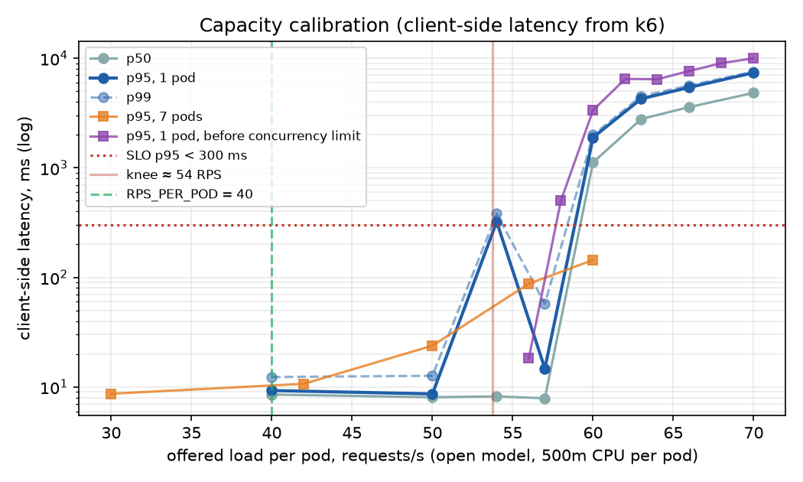
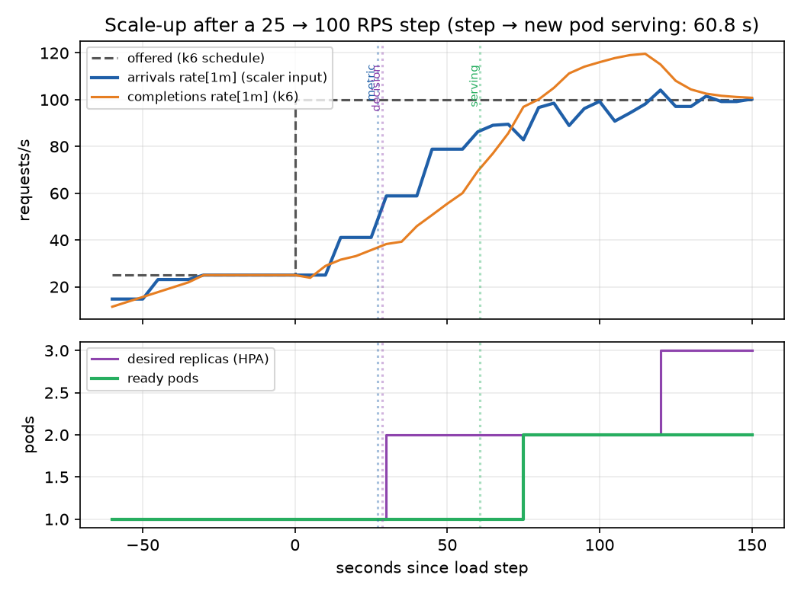

# Predictive Autoscaling for Kubernetes

Can a forecast-driven autoscaler beat reactive scaling **at equal cost**? This project
measures it. Everything runs locally on a [kind](https://kind.sigs.k8s.io/) cluster.

A reactive autoscaler only adds pods after load has already risen. On this setup a new pod
starts serving about **60–75 s after a load step** ([measured](docs/methodology.md#scale-up-lag)),
and requests queue in the meantime. The plan is to forecast request arrivals and scale
ahead of them, then compare that against reactive scaling with different amounts of
headroom. Each strategy is run against the same load traces and scored on cost and on SLO
violations.

> **Status:** work in progress. The cluster, the demo app and the capacity calibration are
> done. The load traces, the forecaster and the experiments are next. No claim is made yet
> about whether prediction helps; that is what the experiment is for.

## How the comparison works

| Arm | Scaling |
|---|---|
| A | Kubernetes HPA on CPU, 70 % of the request (the common default) |
| R100 / R80 / R60 | KEDA on request arrivals, targeting 100 / 80 / 60 % of a pod's capacity |
| C | KEDA on the forecast only |
| D | Hybrid: max(forecast, reactive) |

- **SLO:** client-side p95 latency < 300 ms, measured by k6.
- **SLO violations:** minutes in which the SLO is broken.
- **Cost proxy:** replica-seconds, priced at a stated reference instance price.
- Reactive scaling with more headroom costs more and violates the SLO less, so the
  R100/R80/R60 arms trace a cost vs. SLO-violation curve. Prediction only wins if it lands
  **below that curve**, not merely if it beats one reactive configuration.

## Architecture

```
  tools node (CPUs 0-5)                         app node (CPUs 6-9)
 ┌──────────────────────────────────┐          ┌──────────────────────┐
 │ k6 ──── HTTP /work ──────────────┼────────▶ │ web pods (Go, 500m)  │
 │  │ remote-write (latency, SLO)   │          │  /metrics            │
 │  ▼                               │          └──────────┬───────────┘
 │ Prometheus ◀──── scrape ─────────┼─────────────────────┘
 │  │      ▲                         │
 │  │      └── forecaster (planned) │
 │  ▼                               │
 │ KEDA ──▶ HPA ──▶ scales web      │
 └──────────────────────────────────┘
```

- The **app node is pinned to its own CPUs**, so load generation and monitoring do not
  steal CPU from the app being measured.
- Scalers read `http_requests_received_total` (arrivals), not completions or CPU. An
  overloaded pod completes fewer requests, but the arrival count still shows the real
  demand.
- **Latency is measured by k6 on the client side.** It includes queueing, which
  server-side metrics miss.

## Calibration results

Details, raw data and how to reproduce: **[docs/methodology.md](docs/methodology.md)**.

| Constant | Value |
|---|---|
| CPU per request | ≈ 8.5 ms (`WORK_ITERATIONS=150000`) |
| Knee of one 500m pod | ≈ 54 RPS (saturates at 58–60) |
| `RPS_PER_POD` | 40 (75 % of the knee) |
| Scale-up lag, step → new pod serving | 60.3–60.9 s measured, 60–75 s expected |
| Replicas | min 2, max 7 |





## Repository layout

| Path | What |
|---|---|
| `app/` | Demo app in Go: CPU-bound `/work` handler with a concurrency limit, a startup delay, `/ready`, `/healthz` and Prometheus `/metrics` |
| `deploy/kind/` | kind cluster config, plus `up.sh`, which pins the node containers to CPU sets |
| `deploy/monitoring/`, `deploy/keda/` | Helm values for kube-prometheus-stack and KEDA |
| `deploy/app/` | Deployment, Service, PodDisruptionBudget, ServiceMonitor |
| `deploy/calibration/` | ScaledObject used by the lag measurement |
| `loadtest/` | k6 scripts, and scripts that run k6 inside the cluster and measure scale-up lag |
| `experiments/analysis/` | Python analysis and plots |
| `experiments/results/` | Raw results of every run that the docs cite |
| `docs/` | Methodology and figures |

## Running it

**Requirements**
- Docker Desktop with at least 8 CPUs (10 recommended) and about 8 GB of memory.
- `kind`, `kubectl`, `helm`, Go 1.26 and Python 3.12.
- k6 runs inside the cluster, so it does not need to be installed locally.

```sh
make up          # kind cluster + kube-prometheus-stack + KEDA (pinned chart versions)
make deploy      # build the app image, load it into kind, deploy it
make status      # nodes, CPU allocatable, pods

make test        # Go unit tests
make calibrate   # stepped load against one pod  -> knee and RPS_PER_POD
make lag         # one 25 -> 100 RPS step with reactive KEDA -> scale-up lag breakdown

make down        # delete the cluster
```

`make calibrate` and `make lag` write to `experiments/results/calibration/` with a timestamp.
The analysis scripts use the virtualenv that `make venv` creates.

## Roadmap

- [x] **Phase 0**: kind cluster with CPU pinning, Prometheus, KEDA
- [x] **Phase 1**: demo app
- [x] **Phase 2**: capacity calibration and scale-up lag
- [ ] **Phase 3**: load traces and the k6 trace player. The synthetic traces vary in
  amplitude, peak timing and trend; a real Wikipedia pageview trace is also included.
- [ ] **Phase 4**: forecaster (Python, reads Prometheus, exports a forecast metric)
- [ ] **Phase 5**: scaling arms (HPA, reactive KEDA at three headroom levels, forecast, hybrid)
- [ ] **Phase 6**: experiment harness (repeated runs, arm order rotated between repetitions)
- [ ] **Phase 7**: analysis: cost vs. SLO-violation frontier, startup-delay sweep
- [ ] **Phase 8**: fault injection (kill the forecaster mid-run; the fallback should keep the service healthy)
