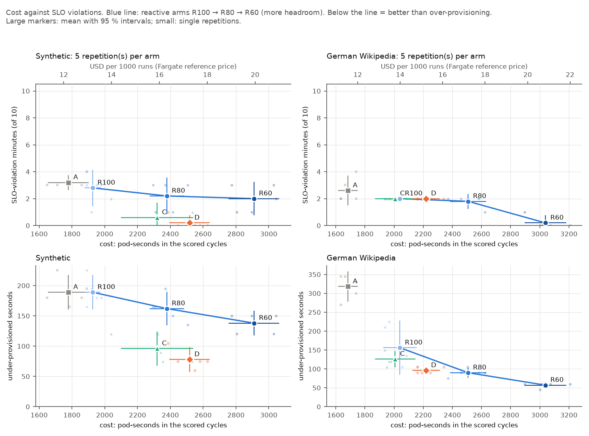

# Predictive Autoscaling for Kubernetes

[](https://github.com/aritrabiswas2004/k8s-predictive-autoscaler/actions/workflows/ci.yml)

Scale your Deployments **before** traffic arrives. A small forecaster reads your request
rate from Prometheus, predicts the peak of the next one to two minutes from the daily
pattern, and exports it as a metric. [KEDA](https://keda.sh/) scales on that forecast and on
the current request rate together, so predictable load gets pods early and unexpected load
is still handled the usual way.

- **Ahead of the load.** New pods are ready when the daily ramp starts, not a minute after.
- **Safe by default.** If the forecaster is down, has no history yet or cannot reach
  Prometheus, it exports nothing, and scaling falls back to the current request rate.
- **Plain Kubernetes.** One Deployment, one ScaledObject with two Prometheus triggers. No
  CRDs or operators beyond KEDA.
- **Observable.** Forecast accuracy, coverage and freshness are exported as metrics, with a
  Grafana dashboard and alerts included.

## How it works

```
         ┌─────────────────────────── scales ────────────────────────────┐
         ▼                                                               │
  traffic ──▶ your pods ── request count ──▶ Prometheus ──▶ KEDA ──▶ HPA
                                              │      ▲
                                     history  │      │  forecast_rps
                                              ▼      │
                                            forecaster
```

1. Your app exposes a request counter, and Prometheus scrapes it.
2. Every 30 s the forecaster reads the last three cycles (for example, three days) of the
   request rate, forecasts the **peak** over a window that starts as far ahead as a new pod
   needs to become ready, and exports the upper bound of that forecast as `forecast_rps`.
3. A KEDA ScaledObject has two triggers: `forecast_rps` and the current request rate. The
   HPA follows whichever asks for more pods.

The default model is seasonal naive ("same as one cycle ago") with an empirical upper bound.
Holt-Winters is also available.

## Quick start: try it locally

This runs the whole stack on a [kind](https://kind.sigs.k8s.io/) cluster, with a demo
service and a load generator, in about 30 minutes.

**Requirements:** Docker Desktop with at least 8 CPUs (10 recommended) and about 8 GB of
memory, plus `kind`, `kubectl`, `helm`, `make` and Python 3.12. The load generator (k6)
runs inside the cluster.

```sh
git clone https://github.com/aritrabiswas2004/k8s-predictive-autoscaler.git
cd k8s-predictive-autoscaler

make venv                # Python virtualenv for the helper scripts
make up                  # kind cluster, Prometheus, KEDA, metrics-server (pinned versions)
make deploy              # build the demo service and deploy it
make forecaster-deploy   # build and deploy the forecaster
make arm ARM=d           # attach the predictive autoscaler to the demo service
make arm-smoke ARM=d     # replay 10 minutes of daily-pattern traffic against it
make arm-status          # replicas, and how many pods each trigger asks for
```

The forecaster needs 10 minutes of history before it exports anything, and it predicts from
the traffic it has seen. Run `make arm-smoke ARM=d` a second time to watch it add pods ahead
of each ramp.

To watch it in Grafana:

```sh
kubectl -n monitoring get secret kube-prometheus-stack-grafana \
  -o jsonpath='{.data.admin-password}' | base64 -d; echo     # password for user "admin"
kubectl -n monitoring port-forward svc/kube-prometheus-stack-grafana 3000:80
```

Open http://localhost:3000 and the dashboard **Predictive autoscaling: forecast**.

`make down` deletes the cluster.

## Install on your cluster

### Prerequisites

- Kubernetes with [KEDA](https://keda.sh/docs/deploy/) 2.x (tested with 2.21).
- Prometheus scraping your service, with at least 3 cycles of retention (3 days for a daily
  pattern).
- A Prometheus query that returns your service's request rate as **one** series, for
  example `sum(rate(http_requests_total{service="checkout"}[1m]))`. A counter that counts
  requests when they arrive is best: counters of completed requests, like CPU usage, stop
  rising when pods are overloaded, which is exactly when more pods are needed.
- Traffic with a repeating pattern, usually daily.

### 1. Build and push the forecaster image

There is no published image yet.

```sh
docker build -t <registry>/predictive-forecaster:0.1.0 forecaster/
docker push <registry>/predictive-forecaster:0.1.0
```

### 2. Deploy the forecaster

Start from [`deploy/forecaster/`](deploy/forecaster/) and change:

- `image:` to the image you pushed.
- Remove `nodeSelector: role: tools`. It is specific to the local test cluster.
- The environment variables, for example for a daily pattern:

```yaml
env:
  - name: PROMETHEUS_URL
    value: http://prometheus-operated.monitoring.svc:9090
  - name: QUERY
    value: sum(rate(http_requests_total{service="checkout"}[1m]))
  - name: MODELS
    value: naive
  - name: CYCLE_SECONDS        # one day
    value: "86400"
  - name: STEP_SECONDS         # keeps 3 days of history under Prometheus' 11,000-point limit
    value: "60"
  - name: LEAD_SECONDS         # pod start-up time + 30 s, rounded up to a multiple of STEP_SECONDS
    value: "120"
  - name: WINDOW_SECONDS
    value: "60"
  - name: RPS_PER_POD          # same as the ScaledObject threshold
    value: "40"
  - name: MAX_REPLICAS         # same as maxReplicaCount
    value: "20"
```

Then apply it:

```sh
kubectl apply -f deploy/forecaster/   # Deployment, Service, ServiceMonitor, alerts, dashboard
```

`servicemonitor.yaml`, `alerts.yaml` and `dashboard.yaml` assume the Prometheus Operator
(for example kube-prometheus-stack). Your Prometheus must select them: kube-prometheus-stack
by default only picks up ServiceMonitors and rules carrying its `release` label. Without the
operator, scrape `forecaster:8000/metrics` with your own scrape config and skip those three
files. The dashboard's queries use the demo
service's metric (`http_requests_received_total{app="web"}`); edit them to match `QUERY`.

Run one forecaster per scaled workload.

### 3. Add the ScaledObject

Use the same threshold for both triggers: the request rate one pod should handle. Remove
any existing HPA on the Deployment first, because two autoscalers would fight over the
replica count.

```yaml
apiVersion: keda.sh/v1alpha1
kind: ScaledObject
metadata:
  name: checkout
spec:
  scaleTargetRef:
    name: checkout                  # your Deployment
  minReplicaCount: 2
  maxReplicaCount: 20
  triggers:
    - type: prometheus              # predictive: forecast peak of the coming window
      name: forecast
      metricType: AverageValue
      metadata:
        serverAddress: http://prometheus-operated.monitoring.svc:9090
        query: max(forecast_rps{model="naive",bound="upper"})
        threshold: "40"
    - type: prometheus              # reactive: the current request rate
      name: arrivals
      metricType: AverageValue
      metadata:
        serverAddress: http://prometheus-operated.monitoring.svc:9090
        query: sum(rate(http_requests_total{service="checkout"}[1m]))
        threshold: "40"
```

If you run several forecasters, add a label selector to the forecast query, for example
`max(forecast_rps{model="naive",bound="upper",namespace="checkout"})`. A complete example,
with the scaling behaviour used in testing, is
[`deploy/arms/d-hybrid.yaml`](deploy/arms/d-hybrid.yaml).

### 4. Check that it works

```sh
kubectl get scaledobject checkout        # READY and ACTIVE
kubectl get hpa                           # the HPA that KEDA created, with both metrics
```

In Prometheus:

- `forecast_history_seconds` grows until it reaches 2 cycles. Until then nothing is
  exported, and the ScaledObject scales on the request rate alone.
- `forecast_rps{bound="upper"}` should run ahead of the request rate by about
  `LEAD_SECONDS`.

### Choosing the settings

| Setting | How to choose it |
|---|---|
| Threshold / `RPS_PER_POD` | The request rate one pod handles while still meeting your latency target, with some margin. Load-test one pod to find where latency climbs, and use about 75 % of that. |
| `LEAD_SECONDS` | How long a new pod takes from creation to serving traffic, plus 30 s. |
| `WINDOW_SECONDS` | 60 s is a good default. The forecast covers the peak of `[now + LEAD, now + LEAD + WINDOW]`. |
| `CYCLE_SECONDS` | The length of the repeating pattern: `86400` for daily. |
| `STEP_SECONDS` | Keep `HISTORY_CYCLES × CYCLE_SECONDS / STEP_SECONDS` under 11,000 (Prometheus' limit per query). |
| `MODELS` | `naive` for long cycles. Holt-Winters fits one seasonal term per step, which is slow for a daily cycle at a fine step. |

## Configuration

Every setting is an environment variable on the forecaster.

| Variable | Default | Meaning |
|---|---|---|
| `PROMETHEUS_URL` | `http://kube-prometheus-stack-prometheus.monitoring.svc:9090` | Prometheus to read from |
| `QUERY` | `sum(rate(http_requests_received_total{app="web"}[1m]))` | Request rate to forecast; must return one series |
| `MODELS` | `naive,holtwinters` | Models to run: `naive`, `holtwinters` |
| `CYCLE_SECONDS` | `300` | Length of the repeating pattern (the demo compresses a day to 5 minutes) |
| `STEP_SECONDS` | `15` | Sample spacing of the history; cycle, lead and window must be multiples of it |
| `HISTORY_CYCLES` | `3` | Cycles of history each fit uses |
| `MIN_HISTORY_CYCLES` | `2` | Below this, export nothing |
| `MAX_GAP_STEPS` | `2` | Gaps up to this many samples are interpolated; longer gaps cut the history |
| `LEAD_SECONDS` | `60` | Forecast window starts this far ahead |
| `WINDOW_SECONDS` | `60` | Forecast window length |
| `UPPER_QUANTILE` | `0.9` | One-sided upper bound that KEDA scales on |
| `RPS_PER_POD` | `40` | Used with `MAX_REPLICAS` to cap forecasts at what the maximum replica count can serve |
| `MAX_REPLICAS` | `7` | See `RPS_PER_POD` |
| `INTERVAL_SECONDS` | `30` | How often to forecast |
| `SMAPE_SAMPLES` | `10` | Forecasts in the rolling accuracy metric |
| `QUERY_TIMEOUT_SECONDS` | `10` | Prometheus query timeout |
| `PORT` | `8000` | Port of `/metrics` |

## Metrics

| Metric | Labels | Meaning |
|---|---|---|
| `forecast_rps` | `model`, `bound` (`upper`, `mean`) | Forecast peak request rate for the coming window; scale on `bound="upper"` |
| `forecast_last_success_timestamp_seconds` | `model` | Time of the last successful forecast |
| `forecast_history_seconds` | | Usable history; nothing is exported below `MIN_HISTORY_CYCLES` |
| `forecast_smape` | `model` | Rolling forecast error (0.1 = 10 %) against the realized peak |
| `forecast_coverage_ratio` | `model` | Share of recent windows whose peak stayed under the upper bound (target ≈ `UPPER_QUANTILE`) |
| `forecast_fit_duration_seconds` | `model` | Duration of the last fit |
| `forecast_errors_total` | `stage`, `model` | Failed forecast attempts |

Alerts in [`deploy/forecaster/alerts.yaml`](deploy/forecaster/alerts.yaml):
**ForecastStale** (no fresh forecast for 60 s) and **ForecastInaccurate** (rolling error
over 40 % for 10 minutes).

## When things go wrong

| Situation | What the forecaster does | What scaling does |
|---|---|---|
| Not enough history yet | Exports nothing | Scales on the request rate alone |
| Prometheus query fails | Keeps the last forecast until its window has passed, then exports nothing | Same as above once the forecast is gone |
| One model fails | Stops exporting that model only | Unaffected if it is not the model you scale on |
| Forecaster down | Its series go stale; **ForecastStale** fires | Scales on the request rate alone |
| Absurd forecast | Capped at `MAX_REPLICAS × RPS_PER_POD` | Never more than `maxReplicaCount` |

A missing forecast reads as 0 in KEDA, so the request-rate trigger decides alone. KEDA's
`fallback` applies to the whole ScaledObject, so it only takes over if Prometheus itself is
unreachable. The demo's fault-injection runs kill the forecaster mid-run under load to check
this.

## Performance

The predictive autoscaler (**D**) was compared with five other setups on the demo service,
5 runs each, on two traffic patterns: a synthetic daily pattern whose days vary in height
and timing, and a real week of German Wikipedia traffic. The other setups are the default
HPA on CPU (**A**), KEDA on the current request rate with 0, 20 and 40 % spare capacity
(**R100**, **R80**, **R60**), and the forecast alone (**C**). A minute counts as slow if
its p95 latency is over 300 ms or more than 5 % of requests failed.



| Setup | Varying daily traffic: slow minutes (of 10) | Cost vs R100 | Wikipedia: slow minutes (of 10) | Cost vs R100 |
|---|---:|---:|---:|---:|
| A: HPA on CPU | 3.2 | −8 % | 2.6 | −18 % |
| R100: request rate | 2.8 | — | 2.0 | — |
| R80: request rate, 20 % spare | 2.2 | +24 % | 1.8 | +23 % |
| R60: request rate, 40 % spare | 2.0 | +51 % | 0.2 | +49 % |
| C: forecast only | 0.6 | +20 % | 2.0 | −2 % |
| **D: forecast + request rate** | **0.2** | +31 % | 2.0 | +9 % |

- **Varying daily traffic:** D cut slow minutes from 2.8 to 0.2, with 13 % fewer
  pod-seconds than adding 40 % spare capacity, which still left 2.0 slow minutes.
- **Smooth daily traffic:** reactive scaling already keeps up, so D performs the same as
  R100 at 9 % more cost. The remaining slow minutes are a sudden spike that no forecast can
  see; only spare capacity absorbs it.
- **Slow-starting pods gain the most.** With a 30 s or 60 s start-up, D's advantage was
  clear. With pods that start instantly, it was too small to tell apart from noise.

All results, with confidence intervals: [docs/results-tables.md](docs/results-tables.md).
How the tests work: [docs/methodology.md](docs/methodology.md).

## Testing

Unit tests need Go 1.26 and Python 3.12, but no cluster:

```sh
make venv && make test   # Go, forecaster, load-generator and manifest tests
```

To benchmark the autoscaler yourself on the local cluster (after the quick start):

```sh
make arm ARM=r100                  # switch setup: a, r100, r80, r60, c or d
make arm-smoke ARM=r100            # 10-minute smoke test against it
make experiment-smoke              # every setup once (~1.5 h)
make experiment GRID=main          # the full comparison (60 runs, ~27 h; resumable)
make experiment GRID=sweep         # pod start-up delay 0 / 30 / 60 s (~8 h)
make experiment GRID=fault         # kill the forecaster mid-run
make analyze                       # tables and charts from the saved runs (no cluster needed)
```

`make analyze` on a fresh clone rebuilds every result above from the raw data in
[`experiments/results/runs/`](experiments/results/runs/).

## Limitations

- **One repeating pattern.** A daily cycle does not know about weekends or holidays; the
  request-rate trigger covers the difference.
- **Warm-up.** Nothing is forecast until `MIN_HISTORY_CYCLES` cycles of history exist (2
  days for a daily cycle).
- **Tested at small scale.** Benchmarks ran on a local cluster with days compressed to 5
  minutes. The settings for a 24-hour cycle follow the same rules but have not been
  benchmarked at that scale.
- **Predictable load only.** Sudden spikes are not forecast; keep spare capacity if you
  need to absorb them.

## Repository layout

| Path | What |
|---|---|
| `forecaster/` | The forecaster (Python): models, service, tests, Dockerfile |
| `deploy/forecaster/` | Forecaster Deployment, Service, ServiceMonitor, alerts, Grafana dashboard |
| `deploy/arms/` | ScaledObjects and HPA for every tested setup; `d-hybrid.yaml` is the predictive autoscaler |
| `app/` | Demo service (Go) used for testing |
| `deploy/` | Local test cluster: kind config, monitoring, KEDA, demo service |
| `loadtest/` | Traffic patterns and the k6 scripts that replay them |
| `experiments/` | Benchmark harness, analysis and raw results |
| `docs/` | [Methodology](docs/methodology.md), [results](docs/results-tables.md) and charts |
