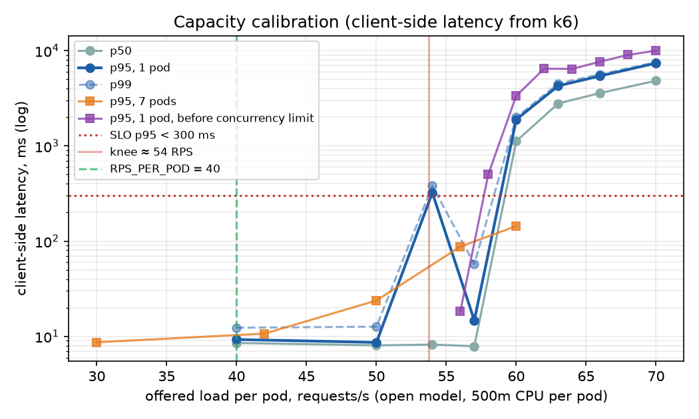
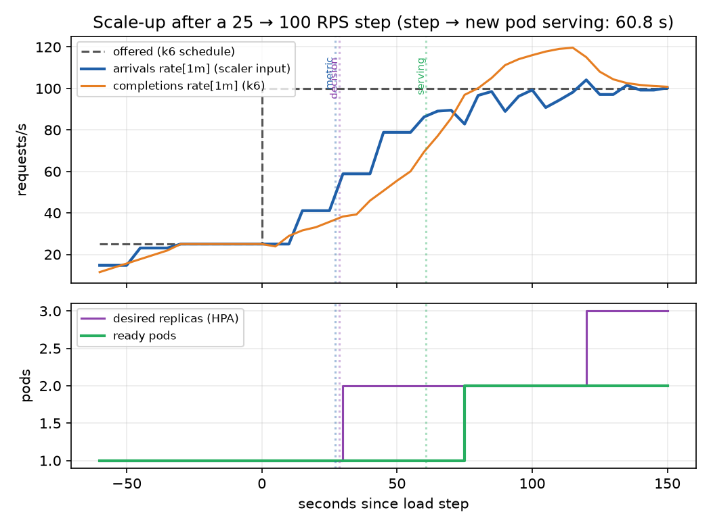
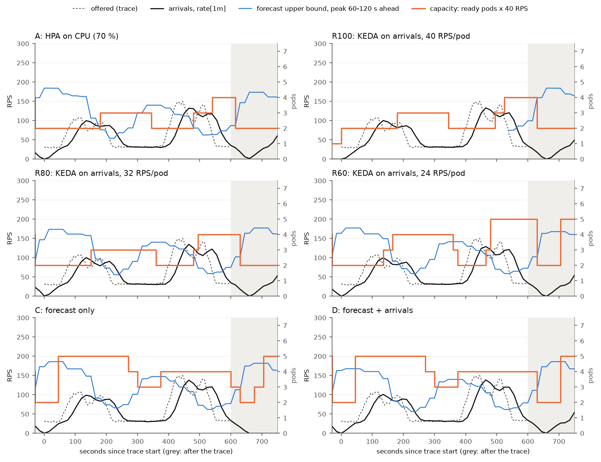

# Methodology

How the experiment is designed, what keeps it fair, and how its constants were measured.
Every number here comes from a run whose raw output is in `experiments/results/`; the
commands to reproduce it are at the end of each section. The results are in
[results.md](results.md), and what could still be wrong with them is under
[threats to validity](#threats-to-validity).

## Design

**Question.** Does scaling on a forecast of the coming load beat scaling on the current load
*at equal cost*, and under which conditions?

**Testbed.** One laptop runs a three-node [kind](https://kind.sigs.k8s.io/) cluster. A Go
demo service (`web`) counts each request on arrival and burns a fixed amount of CPU per
request. Prometheus scrapes the arrival counter every 15 s. The forecaster reads that history
and writes back a forecast of the coming peak, and KEDA turns the forecast, the current
arrival rate or both into a replica count for the HPA ([diagram](../README.md#how-it-works)).
k6 replays the load. The app pods have a node with pinned CPUs to themselves; everything else
shares the other node and the control plane.

**Arms.** Six autoscaler setups, which differ only in the signal and the target per pod
([table](#scaling-arms)):
- A: the default HPA on CPU;
- R100, R80, R60: KEDA on the arrival rate, with targets of 100, 80 and 60 % of 40 RPS
  per pod;
- C: the forecast alone;
- D: the forecast and the arrival rate together.

**Workloads.** Five compressed "days" of 300 s each. The first three are history (warm-up for
the forecaster, not scored) and the last two are scored. Each has an 80 s spike in the last
day, at a second that depends on the seed and that no forecast can see
([load traces](#load-traces)). There are two workloads:
- **synthetic**: a daily shape whose height and timing vary from day to day;
- **German Wikipedia**: a real week, scaled to the testbed.

**Measures.** Per run, over the two scored days:
- *SLO-violation minutes*: minutes whose client-side p95 is over 300 ms, or in which more
  than 5 % of the offered requests failed or were never sent;
- *pod-seconds*: the cost.

[Details](#what-a-run-is-scored-on).

**Comparison.** The reactive arms R100, R80 and R60 trace a cost-versus-violations frontier:
what buying headroom achieves. An arm is better than over-provisioning only if it lies below
that frontier, with a 95 % interval that clears it ([the frontier test](#analysis)). Lower
violations at a higher cost, alone, show nothing.

**Grids** ([harness](#experiment-harness)):
- **main:** all six arms × both workloads × seeds 1–5, start-up delay 30 s. 60 runs.
- **sweep:** R100, R80 and D × synthetic × seeds 1–3 × start-up delay 0 and 60 s. 18 runs.
- **fault:** C and D × both workloads × seeds 1–3, with the forecaster killed for 3 minutes
  mid-run. 12 runs.

### Fairness controls

- **Same load.** Within a repetition every arm replays the identical trace: same seed, same
  cycle variation, same spike at the same second.
- **Same everything else, checked mechanically.**
  - Every arm has the same resources, replica bounds (2–7) and HPA behaviour block.
  - `make arm-check` compares the applied manifests, and CI compares them as text.
- **One arm at a time, with a clean reset.** Before each run:
  - the previous scaler is removed;
  - the service goes back to exactly 2 Ready pods;
  - the arrival rate must fall below 1 RPS, so no run inherits the previous run's 1-minute
    rate.
- **Order effects removed.**
  - The arm order rotates by one position per repetition, so no arm goes first twice on a
    workload, and the workload order alternates.
  - Every run starts after a deterministic 0–15 s jitter, so runs don't all hit the same
    phase of the HPA's 15 s sync.
- **Same signals.**
  - Every target has the same scrape interval and the same `rate[1m]` window.
  - Scalers and forecaster read arrivals, never CPU, replicas or completions. Those signals
    flatten under overload or feed back on the scaler's own decisions.
- **Open-model load.** k6 sends on schedule whether or not the service keeps up. A request
  that is never sent counts against the arm, not for it.
- **Paired statistics.** Arms are compared within a repetition, where the trace is identical.
- **Recorded, not assumed.** Each run records:
  - the Git commit, and whether the working tree differed from it;
  - the chart and Kubernetes versions;
  - the CPU of every node container.

### Assumptions

- **One resource.** The service is CPU-bound and stateless, with a fixed cost per request.
  One pod carries a known rate (40 RPS, 75 % of the measured knee), so the pods a load needs
  follow from its rate.
- **One repeating pattern.** The load has a single seasonal period, the "day", compressed to
  300 s. The forecaster learns it from three days of history.
- **No node waits.** Scale-up lag is detection, the HPA sync, scheduling and the pod's
  start-up delay (30 s by default, swept 0–60 s). Nodes already exist, so no pod waits for
  one.
- **Users see the client side.** The SLO is measured at the load generator, per minute, with
  failed and unsent requests counted as bad.
- **Cost is pod-seconds.** Every pod costs the same per second, as on AWS Fargate. There is no
  bin packing onto nodes.
- **The monitoring stays up.** Prometheus is assumed available. Only the forecaster is killed
  in the fault runs.

## Constants

| Constant | Value | Source |
|---|---|---|
| SLO | client-side p95 < **300 ms** | fixed before calibration, kept |
| SLO-violation minute | a scored minute with p95 > 300 ms, or > 5 % of its offered requests failed or unsent | [harness](#what-a-run-is-scored-on) |
| Pod resources | 500m CPU, 128Mi (request = limit) | `deploy/app/deployment.yaml` |
| `WORK_ITERATIONS` | **150000** (≈ 8.5 ms of CPU per request) | [capacity](#capacity) |
| `WORK_CONCURRENCY` | GOMAXPROCS = **2** for a 500m limit | [overload behaviour](#overload-behaviour-two-fixes) |
| Knee (1 pod) | **≈ 54 RPS** | [capacity](#capacity) |
| `RPS_PER_POD` | **40** (75 % of the knee) | [capacity](#capacity) |
| `STARTUP_DELAY_SECONDS` | 30 (swept 0/30/60 later, R6) | plan |
| Scale-up lag, step → new pod serving | **≈ 60 s measured, 60–75 s expected** | [lag](#scale-up-lag) |
| `minReplicaCount` / `maxReplicaCount` | **2 / 7** | [replica bounds](#replica-bounds) |
| Load traces | 5 cycles × 300 s (3 history, 2 scored), seeds 1–5 per workload | [load traces](#load-traces) |
| Connections | new connection per request (`noVUConnectionReuse`) | [load generation](#load-generation-one-connection-per-request) |
| `rate[1m]` delay | the arrival series trails real arrivals by **≈ 28 s** | [forecaster](#what-it-forecasts-and-how-far-ahead) |
| Forecast window | peak over **[now + 60 s, now + 120 s]** (LEAD = startup delay + 30 s) | [forecaster](#what-it-forecasts-and-how-far-ahead) |
| Forecast upper bound | one-sided **90 %** | [forecaster](#models) |
| Model the scalers read | **seasonal naive** | [decision](#decision-arms-c-and-d-scale-on-seasonal-naive) |
| Scale-down stabilization | **120 s** in every arm; otherwise the Kubernetes default behaviour | [scaling arms](#scaling-arms) |
| Fallback (arms C, D) | **7** replicas after 3 failed scaler polls | [scaling arms](#when-the-forecast-disappears) |

## Setup

- macOS arm64 host (4 performance + 6 efficiency cores), Docker Desktop with 10 CPUs.
- kind cluster, Kubernetes v1.37.0. The app node container is pinned to CPUs 6–9; the tools
  node and control plane share 0–5. The app node's allocatable CPU is 4.
- One app pod per measurement unless stated. k6 v2.3.0 runs **in the cluster on the tools
  node** (`loadtest/run-k6.sh`), hits `http://web.default.svc.cluster.local/work` through the
  Service, and remote-writes its metrics to Prometheus.
- Open model only: k6 `constant-arrival-rate`, so the offered rate does not slow down when
  the server does. Request timeout 10 s.
- CPU of the three kind node containers is sampled with `docker stats` during every run
  (`*.docker-stats.csv`), because CPU pinning isolates scheduling but not the hardware
  (a saturated tools node slowed the app by ~40 % in Phase 1).

## Capacity

**Method.** One pod, replicas fixed. Each step is its own k6 scenario at a constant arrival
rate: 50 s per step, the first 10 s excluded as warm-up, 20 s idle between steps so a backlog
can drain. Latency is k6's `http_req_duration` (client side, includes queueing).

**One pod** (`sweep-1pod.json`):

| offered RPS | achieved | p50 ms | p95 ms | p99 ms |
|---:|---:|---:|---:|---:|
| 40 | 40.0 | 8.5 | 9.3 | 12.3 |
| 50 | 50.0 | 8.0 | 8.6 | 12.7 |
| 54 | 54.0 | 8.2 | **322** | 381 |
| 57 | 57.0 | 7.9 | 14.7 | 57.4 |
| 60 | 58.7 | 1122 | 1896 | 1996 |
| 63 | 58.7 | 2792 | 4273 | 4520 |
| 70 | 62.1 | 4838 | 7395 | 7572 |

A 500m pod saturates at about **58–60 RPS** (achieved throughput stops rising), i.e. about
8.5 ms of CPU per request. Below that, latency is flat at ~8 ms; above it, the queue grows
without bound and p95 goes to seconds. That's the expected cliff for a CPU-capped server.

Near the cliff the result is noisy: 54 RPS crossed the SLO while 57 did not. Utilisation is
above 90 % there, so a short slowdown (macOS moving the VM's threads to an efficiency core, or
lowering clocks) builds a queue that a few seconds of slack cannot drain. Earlier sweeps
before the fixes below put the crossing at 57–60 RPS. The **knee is taken as 54 RPS**, the
lowest offered rate that has crossed the SLO in any sweep.

**`RPS_PER_POD = floor(0.75 × 53.7) = 40`**, inside the plan's 70–80 % band.

**Seven pods** (the maximum; `sweep-7pods.json`), to check that per-pod capacity holds when
the app node is busy:

| offered RPS | per pod | p50 ms | p95 ms | p99 ms |
|---:|---:|---:|---:|---:|
| 210 | 30 | 7.7 | 8.7 | 13.7 |
| 294 | 42 | 7.6 | 10.7 | 43.3 |
| 350 | 50 | 7.6 | 23.8 | 80.2 |
| 392 | 56 | 8.3 | 87.6 | 172 |
| 420 | 60 | 14.9 | 144 | 215 |

At 40 RPS per pod, seven pods have p95 ≈ 10 ms, so `RPS_PER_POD` holds at full scale.
Seven pods degrade *more gently* per pod than one. The likely cause is that with 3.5 cores
busy, macOS keeps the VM on performance cores and at high clocks, while a single busy pod can
end up on an efficiency core. **Per-pod capacity therefore depends a little on total load.**
This is a threat to validity: under-provisioned moments in a reactive arm are partly cushioned
when the node is busy. `RPS_PER_POD` is set from the more pessimistic one-pod curve.

**Load generator headroom.** k6 delivered 420 RPS with 0 dropped iterations. During the
7-pod sweep the tools node averaged 14 % of one CPU (peak 45 %), far below saturation.

Reproduce: `make calibrate` (one pod) or `./loadtest/run-k6.sh loadtest/k6/calibrate.js OUT STEPS=...`
against a fixed replica count, then `experiments/analysis/calibration.py OUT.json`.

## Overload behaviour: two fixes

The first calibration and lag runs exposed two ways the app failed under overload. Both would
have punished under-provisioned arms through artefacts rather than through latency. Raw data
from before the fixes is in `experiments/results/calibration/pre-concurrency-limit/`.

1. **Probes killed overloaded pods.** At 70 RPS on one pod, `/healthz` took longer than the
   1 s default probe timeout, the kubelet restarted the container, and for the 30 s startup
   delay the Service had no endpoints ("connection refused"). The probes now tolerate
   overload: readiness drops a pod after ~6 s unresponsive (`timeoutSeconds: 2`,
   `failureThreshold: 3`), and liveness restarts it only after ~60 s (`timeoutSeconds: 5`,
   `failureThreshold: 6`). Neither changes time-to-Ready nor draining.
2. **Overload blinded the scaler.** With no concurrency limit, an overloaded pod ran hundreds
   of CPU-burning goroutines on a 0.5-CPU quota. That starved the rest of the process: the
   accept loop, so `http_requests_received_total` stopped counting arrivals; `/metrics`, so
   scrapes timed out; and the probes. In one lag run, the arrival rate seen by Prometheus
   *fell* from 25 to 10 RPS when offered load jumped to 100, and KEDA never scaled up. The
   app now runs at most `WORK_CONCURRENCY` (default GOMAXPROCS) requests at once. The rest
   wait on a channel, which uses no CPU, and are counted *before* they wait. A queued
   request whose client gives up is dropped without being worked (status 499).
   `work_requests_queued` exposes the queue. After the fix, arrivals track offered load
   (see the timeline below) and no pod restarted in any run.

## Scale-up lag

**Method.** `loadtest/measure-lag.sh`: one pod, reactive KEDA ScaledObject on
`sum(rate(http_requests_received_total{app="web"}[1m]))` with `AverageValue` threshold 42
(the R100 configuration; minReplicaCount 1 so a step from one pod is easy to read). Before
each rep the script waits for the arrival rate to return to ~0, because a leftover
`rate[1m]` from the previous run made the HPA scale up before the step in the first attempt.
k6 holds 25 RPS for 90 s, then steps to 100 RPS. Timestamps come from:

| mark | source |
|---|---|
| step | first request of the high phase, logged by k6 |
| metric | first moment the scaler query exceeds `threshold × replicas × 1.1` (HPA tolerance), evaluated post hoc at 1 s resolution |
| decision | HPA `SuccessfulRescale` event (1 s resolution) |
| scheduled / started | pod `PodScheduled` condition / container `startedAt` |
| ready | the app's own "startup delay done, ready" log line (the kubelet notices within one 2 s probe period) |
| serving | first `/work` request logged by the new pod |

**Result** (3 reps; `lag-*.lag.json`):

| segment | rep 1 | rep 2 | rep 3 | what it is |
|---|---:|---:|---:|---|
| step → metric | 27.0 | 26.0 | 25.0 | 15 s scrape interval + `rate[1m]` ramping up to the threshold |
| metric → decision | 1.7 | 2.7 | 3.7 | wait for the HPA's next 15 s sync, which asks KEDA's metrics server, which queries Prometheus |
| decision → scheduled | 0.0 | 0.0 | 0.0 | ReplicaSet + scheduler (< 1 s) |
| scheduled → started | 1.0 | 1.0 | 1.0 | image already on the node |
| started → ready | 30.2 | 30.2 | 30.2 | `STARTUP_DELAY_SECONDS` |
| ready → serving | 0.9 | 0.4 | 1.0 | probe + endpoint propagation |
| **step → serving** | **60.8** | **60.3** | **60.9** | |

*The "ready pods" line comes from kube-state-metrics and trails the pod's own log by a scrape
interval.*

Notes:

- **The metric → decision spread is underestimated.** The reps started exactly 5 min apart,
  a multiple of the 15 s HPA sync period, so every step landed at the same phase of the sync
  cycle. In general this segment is anywhere in 0–15 s, which makes the **expected end-to-end
  lag 60–75 s**. The forecaster's lead time should therefore be at least 75 s plus a margin
  (Phase 4).
- **step → metric depends on the step size and the threshold.** It is the time for a 1-minute
  rate to climb past the threshold, so bigger steps are detected faster. At the final
  `RPS_PER_POD = 40` this step crosses about 2 s earlier than at the 42 used here.
- **KEDA's `pollingInterval` doesn't matter here.** KEDA 2.21 warns that it only affects
  scaling to or from zero (or with cached metrics). From 1 to N replicas, the HPA's 15 s sync
  sets the cadence. The arms' ScaledObjects can drop it.
- **Scaling up is stepwise.** The first decision went to 2 pods, because the 1-minute rate
  was still climbing. 3 pods needed the rate above 2 × 42 × 1.1 = 92.4, which a 100 RPS step
  hovers around, and took another 90 s.
- **Keep-alive pins load to old pods.** After the new pod was ready, the old pod still took
  ~64 RPS and the new one ~36. kube-proxy balances *connections*, and k6 VUs keep theirs, so
  only new connections reach new pods. This affects how fast a scale-up relieves overload and
  is a decision for Phase 3 (see below).

Reproduce: `make lag RPS_PER_POD=42` (one rep), then
`experiments/analysis/lag_timeline.py OUT.lag.json OUT` for the plot.

## Replica bounds

- App node allocatable: 4000m CPU. kindnet requests 100m, which leaves 3900m and room for
  **7 pods** of 500m. `maxReplicaCount = 7`.
- `minReplicaCount = 2` (plan), i.e. 80 RPS of capacity at `RPS_PER_POD`.

## Load traces

`loadtest/trace/generate.py` writes a trace: the offered RPS every 5 s, which
`loadtest/k6/trace.js` replays with one `ramping-arrival-rate` stage per point (k6 ramps
linearly between them). It is deterministic: the same seed always gives the same file, so
every arm sees exactly the same load. Seeds 1–5 of both workloads are committed in
`loadtest/trace/out/`, and a test checks that they match the generator.

**Run structure.** Five cycles of 300 s (25 min). Each cycle is a compressed day. The first
three are history: the forecaster learns from them and they are not scored. The last two are
scored, and an unforecastable spike falls in the last one, so no later scored cycle ever has
it in its history.

**Synthetic workload.** A fixed daily shape (night baseline, morning ramp, peak, midday dip,
second peak, evening ramp down), with each cycle varied so that "same as yesterday" is never
the exact answer (plan revision R2):

| Parameter | Default | Why |
|---|---|---|
| Base / nominal peak | 30 / 120 RPS | the base fits within `minReplicaCount` 2 (80 RPS) |
| Amplitude | peak height above base × U(0.8, 1.2) per cycle | varies the peak |
| Timing | shape shifted by U(−0.1, 0.1) × cycle, i.e. ±30 s | varies when the ramp starts |
| Trend | level +10 % over the run | something a seasonal copy misses |
| Noise | × (1 + 0.04 z), z ~ N(0,1) clipped at ±2, every 5 s | short-term jitter |

The night baseline covers both ends of each cycle with 0.1 of a cycle to spare, so the timing
shift never moves load across a cycle boundary.

**Real workload.** Hourly pageviews of German Wikipedia (Wikimedia REST API, `user` agent,
all access), 3–7 March 2025 (Monday to Friday). The raw response is committed in
`loadtest/trace/raw/`. Transformation:

1. One real day becomes one 300 s cycle (1 hour = 12.5 s). Cycles start at 03:00 UTC, the
   daily trough, so cycle boundaries fall at the baseline as in the synthetic shape.
2. Each hourly count is placed at the middle of its hour; points in between are linear
   interpolation.
3. The 5-day minimum maps to 30 RPS and the maximum to 150 RPS (affine). The real ratio is
   about 10× (night to evening peak); keeping it would need a night rate below what two pods
   are for.
4. The same noise and spike as the synthetic trace are added.

German rather than English Wikipedia: almost all of its readers share one time zone, so it
has a clear daily cycle (about 10× from trough to peak), while English Wikipedia's global
audience flattens its cycle to 1.6×. English Wikipedia's 3 March also has a one-off peak from
the Oscars.

**How predictable each workload is.** On the noise-free scored cycles, a forecast of "same as
the previous cycle" has an sMAPE of **10–38 %** on synthetic seeds 1–3 and **2–5 %** on the
Wikipedia week (5–7 % if the window ends on a Saturday). Real daily traffic is very regular.
The two workloads are therefore an easy realistic case and a hard varied case, and the
results will be reported per workload. Prediction winning only on Wikipedia would be a
different finding from winning on both.

**The spike.** +120 RPS on top of the trace for 80 s (5 s rise, 60 s hold, 15 s fall), placed
at a seeded position in the last cycle. Its position depends on the seed only, so seed N has
the same spike in both workloads.

**Constraints from Phase 2, checked by the generator:**

- **R60 must fit.** R60 targets 0.6 × 40 = 24 RPS per pod, so a peak of P needs
  ceil(P / 24) ≤ 7 pods: **P ≤ 168 RPS**, including amplitude, trend and noise. The generator
  fails (it never clips) if a point outside the spike exceeds it. Seeds 1–5 peak at 142–159
  RPS (synthetic) and 146–161 RPS (Wikipedia).
- **Ramps must outrun R100.** A pod at `RPS_PER_POD` has 54 − 40 = 14 RPS of headroom before
  the knee. With n pods and ~60–75 s of lag, a ramp steeper than about 14 n / 60 RPS/s
  outruns reactive scaling: 0.47 RPS/s at 2 pods, 0.7 at 3. The steepest 60 s rise of the
  noise-free level is **1.8–1.9 RPS/s** (synthetic) and **1.1 RPS/s** (Wikipedia), 1.6–4×
  steeper.
- **The spike** may exceed what R60 can provision (seeds 1–5 reach 220–264 RPS); it stays
  below what 7 pods can serve (7 × ~54 ≈ 380 RPS).

## Load generation: one connection per request

kube-proxy balances **connections**, not requests. With keep-alive, k6's VUs stay on the
pods that existed when their connections opened: after a scale-up in Phase 2, the old pod
kept about 64 RPS and the new one got about 36. Traffic from many independent clients, or
through an L7 load balancer, spreads per request instead. `trace.js` therefore sets
`noVUConnectionReuse: true` for every arm, so each request opens a new connection and lands
on a random ready pod. On a 2-minute smoke run at 7 pods, each pod's share was within 10 % of
the busiest's.

Consequences, measured:

- **Capacity is unchanged.** A 1-pod sweep without connection reuse
  (`sweep-1pod-noreuse.json`, the purple curve above) crosses the SLO between 54 and 57 RPS
  (interpolated 54.6), the same knee. `RPS_PER_POD` stays 40. CPU per request rose from
  ~8.5 ms to ~8.7 ms.
- **The tail is fatter near the knee.** Per-pod arrivals are random rather than smooth, so a
  pod sometimes gets several requests at once and exhausts its 50 ms of CPU per 100 ms CFS
  period. In the 1-pod sweep, p99 at 50–54 RPS was 85–105 ms (13 ms with reuse).
- **Ports.** Each request leaves a socket in TIME_WAIT for 60 s, all to one Service IP and
  port. `run-k6.sh` widens the k6 pod's local port range (a namespaced "safe" sysctl) to
  1024–65535, which allows ~1000 new connections/s; the traces need at most ~265.

## Trace replay check

Each workload's seed-1 trace was replayed against **7 fixed replicas, no scaler**
(`make trace-check`), to check that k6 delivers the trace and the app keeps up at maximum
scale. Results in `experiments/results/traces/`.

| Trace | offered | sent | dropped | failed | p95 overall | p95 / p99 in the spike | tools node CPU, mean / max |
|---|---:|---:|---:|---:|---:|---:|---:|
| synthetic-s1 | 109,237 | 109,237 | 0 | 0 | 9.4 ms | 10.3 / 31.0 ms | 10 % / 57 % of a CPU |
| wikipedia-s1 | 133,533 | 133,532 | 0 | 0 | 9.0 ms | 9.0 / 26.6 ms | 12 % / 66 % of a CPU ¹ |

Per cycle, sent / offered was at least 0.9999 in both runs, and nothing was dropped or
failed. (The synthetic run still had 100 pre-allocated VUs and never needed more.) The load generator is not the bottleneck: the tools node stayed far from
saturation.

¹ One sample of 258 % at 1491 s, as k6 finished and built its summary; every other sample
was below 67 %.

A first Wikipedia run with 100 pre-allocated VUs (`check-wikipedia-s1-prealloc100.*`)
dropped 7 of 133,533 requests: k6 needed 102 VUs, and starting VUs mid-run is slow enough to
miss a few scheduled iterations. Its spike also had p95 / p99 of 30 / 294 ms, with 12 % of
CFS periods throttled on the web pods at ~31 RPS per pod. The re-run with 200 pre-allocated
VUs had neither, so the tail was mostly run-to-run noise (laptop scheduling) on top of the
burstiness described above. `trace.js` now pre-allocates 200 VUs.

Reproduce: `make traces`, then `make trace-check TRACE=synthetic-s1` (25 min).

## Forecaster

`forecaster/` (Python, deployed by `make forecaster-deploy` to the tools node). Every 30 s it:

1. reads `sum(rate(http_requests_received_total{app="web"}[1m]))` from Prometheus
   (`query_range`, 15 s steps, the last 3 cycles plus one forecast window for scoring);
2. fits each model on up to 3 cycles (60 samples);
3. exports the **peak over the window [now + 60 s, now + 120 s]**, both the point forecast
   and a one-sided 90 % upper bound. KEDA scales arms C and D on the upper bound.

It runs in every arm (shadow mode), and both models are exported in every run, so forecast
quality is measured everywhere regardless of which model a scaler reads.

### What it forecasts, and how far ahead

**The series lags real arrivals by about 28 s.** The forecaster reads the same 1-minute rate
as the reactive trigger. The rate at time T is the counter increase between the first and
last 15 s scrape inside [T − 60, T], so it averages arrivals over roughly [T − 50, T − 5].
Fitting this against the two recorded trace-check runs gives exactly that: a 45 s trailing
mean ending 5–6 s before T matches the recorded series to within 1 %. The series therefore
trails real arrivals by about 28 s.

**The forecast path is faster than the reactive one.** From a forecast computed at t to a new
pod serving:

| segment | seconds | source |
|---|---:|---|
| Prometheus scrapes the forecaster | 0–15 | scrape interval |
| HPA sync asks KEDA, which queries Prometheus | 0–15 | HPA sync period |
| decision → new pod serving | ≈ 32 | Phase 2: 1 s scheduling and start, 30.2 s startup delay, ~1 s to serve |
| **total** | **32–62** | |

The reactive path's 60–75 s includes ~27 s for the rate to climb past the threshold. The
forecast path skips that.

**The window.** The next forecast comes 30 s later, so each forecast must cover the load
from t + 32 s (best case) to t + 92 s (worst case, plus one interval) in real time. On the
lagged series that is about [t + 60, t + 120]: **LEAD = 60 s, WINDOW = 60 s**. In general,
LEAD = `STARTUP_DELAY_SECONDS` + 30 s, so the lag sweep (startup delay 0 and 60 s, Phase 6)
uses LEAD 30 and 90 s. The end of the window matters less than its start: once the HPA has
scaled up, its 120 s scale-down stabilization keeps the pods for two more minutes.

### Models

Both implement one interface (`forecaster/src/forecaster/models/`), and the service and the
backtest call the same code (`window.predict`).

- **Seasonal naive.** The point forecast is the value one cycle (300 s) earlier. The upper
  bound adds the 90th percentile of the history's seasonal differences y[t] − y[t − 300 s],
  i.e. of the errors this forecast made in the past. That needs two cycles of history, and
  the bound is only ever raised, never lowered below the point forecast.
- **Holt-Winters**: ETS(A,N,A) from statsmodels 0.15 (`ETSModel`), additive error, no trend,
  additive seasonality with a period of 20 samples (300 s / 15 s), estimated initial states,
  analytic prediction intervals. No trend term: three cycles are too short to estimate one,
  and over a two-minute horizon the level update follows slow drift anyway.

**Holt-Winters on three cycles** (plan: "check statsmodels copes"):

- It fits without warnings. A fit takes **24–38 ms** (median per series).
- **The fit degenerates.** Over 54 backtest fits, the optimiser always puts the level
  smoothing at its upper bound (α = 1.0) and the seasonal smoothing at its lower bound
  (γ ≈ 0, at most 0.0001). The 1-minute rate is smooth, so the best one-step predictor is the
  last value, and with γ = 0 the seasonal profile stays at its initial estimate. The forecast
  is therefore "the latest value plus the change the seasonal profile expects over the next
  two minutes". Its intervals grow like a random walk's, from one-step residuals. Those are
  too narrow four to nine steps ahead on an autocorrelated series, which shows up as low
  coverage below.
- statsmodels 0.15's `get_prediction` fails on a bare NumPy array (`'numpy.ndarray' object
  has no attribute 'index'`), so the model passes a pandas Series.

### Failure behaviour

A made-up number is never exported. When the forecaster has nothing valid, the series is
absent, so arm D's reactive trigger decides alone, and arm C falls back to KEDA's `fallback`
([verified](#when-the-forecast-disappears)).

| situation | what is exported |
|---|---|
| less than 2 cycles of history, or no arrival series at all (cold start) | no `forecast_rps` for that model |
| Prometheus query fails | the last good forecast, until its window has passed (120 s after it was made), then nothing. `forecast_last_success_timestamp_seconds` stops advancing |
| a model's fit fails | the same, for that model only. The other model is unaffected |
| gaps in the history | gaps of up to 2 samples are interpolated. A longer gap cuts the history there |
| an absurd forecast | clamped to [0, 7 × 40 = 280] RPS. No lower clamp: `minReplicaCount` already sets the floor, and a floor here would hide the shape |

Exported metrics: `forecast_rps{model, bound="upper"|"mean"}`,
`forecast_last_success_timestamp_seconds{model}`, `forecast_fit_duration_seconds{model}`,
`forecast_smape{model}` and `forecast_coverage_ratio{model}` (over the last 10 forecasts
whose window has since been observed), `forecast_errors_total{stage, model}`,
`forecast_history_seconds`, and the configuration (`forecast_lead_seconds`,
`forecast_window_seconds`, `forecast_upper_quantile`). The Grafana dashboard
"Predictive autoscaling: forecast" (`deploy/forecaster/dashboard.yaml`) plots them.

### Backtest

`make backtest` (`forecaster/backtest/backtest.py`) runs a rolling-origin evaluation.

**Series.** Ten simulated arrival series and the two recorded ones.

- **Simulated**: one per committed trace (seeds 1–5 × 2 workloads), as Prometheus would
  record it. Poisson arrivals at the trace's rate over 7 pods, each pod's counter scraped
  every 15 s at its own phase, read as `sum(rate(...[1m]))`. Against the two recorded runs
  the simulation differs by 3.3 % on average (mean absolute, no bias), about the Poisson
  noise of a 45 s count at 100 RPS.
- **Recorded**: the series from the two trace-check runs
  (`experiments/results/traces/check-*-s1.arrivals.json`).

**Method.**

- **Origins:** every 30 s through the scored cycles. At each origin a model is fitted on the
  preceding 3 cycles and forecasts the window [origin + 60 s, origin + 120 s].
- **Spike windows:** windows overlapping the spike (or the minute after it) are reported
  separately.
- **Scoring:** "peak" is the realized maximum of the series over the window. "Short" is the
  share of windows where the upper bound implies fewer pods than the realized peak needs,
  with pods = ceil(rps / 40) clamped to [2, 7]. "Current" is a reference rather than a model:
  the latest value of the series, which is what a reactive scaler acts on (without its own
  detection delay).

Results (`experiments/results/backtest/`):

| workload | model | windows | peak sMAPE | MASE | 90 % bound covers | short of pods | extra pods | spike windows covered |
|---|---|---:|---:|---:|---:|---:|---:|---:|
| synthetic | seasonal naive | 55 | 21.9 % | 1.33 | 85 % | 4 % | +0.69 | 17 % of 30 |
| synthetic | Holt-Winters | 55 | 21.1 % | 1.15 | 75 % | 5 % | +0.29 | 23 % of 30 |
| synthetic | *current (reference)* | 55 | 66.5 % | 3.57 | 40 % | 42 % | −0.36 | 13 % of 30 |
| Wikipedia | seasonal naive | 55 | 2.8 % | 0.73 | 78 % | 5 % | +0.09 | 13 % of 30 |
| Wikipedia | Holt-Winters | 55 | 5.9 % | 1.54 | 89 % | 0 % | +0.16 | 17 % of 30 |
| Wikipedia | *current (reference)* | 55 | 45.9 % | 9.45 | 24 % | 64 % | −0.47 | 10 % of 30 |

*Simulated series, seeds 1–5. The recorded runs (10 windows each, `backtest.md`) agree in
direction: synthetic sMAPE 29 % for both models, Wikipedia 2.5 % (naive) vs 7.0 %
(Holt-Winters).*

What it shows:

- **Forecasting at this lead is necessary.** Acting on the current rate would be short of
  pods in 42 % (synthetic) and 64 % (Wikipedia) of windows, against at most 5 % for either
  model. A reactive scaler sees the current rate later still, which is the case for
  prediction.
- **Synthetic: no clear winner.** Peak sMAPE is the same (21–22 %). Holt-Winters has the
  lower MASE (1.15 vs 1.33) and costs fewer extra pods (+0.29 vs +0.69). But its "90 %" bound
  covers only 75 % of windows (naive: 85 %), and it is short of pods about as often (5 % vs
  4 %). Neither beats the in-sample naive error (MASE > 1). The timing and amplitude
  variation is what makes this workload hard, by design.
- **Wikipedia: seasonal naive wins clearly** (2.8 % vs 5.9 % sMAPE, MASE 0.73 vs 1.54). Real
  days repeat closely, and Holt-Winters' random-walk level only adds noise to a good seasonal
  copy.
- **The spike is not forecast** (10–23 % of its windows covered), as designed. Afterwards
  both models overshoot for a while: the spike has entered Holt-Winters' level and naive's
  error quantile (visible after 1350 s in the figure).
- **Caveat:** the 55 windows per workload come from 5 seeds with overlapping windows every
  30 s, so they are not independent. Differences of a few percent are within noise.

### Shadow-mode replay

**Setup.** The deployed forecaster ran while each seed-1 trace was replayed against 7 fixed
replicas with no scaler (`make trace-check`, results in `experiments/results/forecaster/`).
k6 delivered both traces in full: 109,236 of 109,237 and 133,532 of 133,533 requests, none
dropped or failed, p95 9.6 and 9.3 ms. The forecaster used about 108 MiB of memory (limit
256 MiB) and about 0.01 CPU.

**Scoring.** `experiments/analysis/forecast_shadow.py` saves the run's series from
Prometheus (`*.series.json`, so the analysis reruns without the cluster). It then scores each
forecast made in the scored cycles against the samples its own window covered, the same way
as the backtest.

| trace | model | windows | peak sMAPE | 90 % bound covers | short of pods | backtest, same recorded trace |
|---|---|---:|---:|---:|---:|---:|
| synthetic-s1 | seasonal naive | 9 | 30.3 % | 89 % | 0 % | 29.4 % |
| synthetic-s1 | Holt-Winters | 9 | 30.8 % | 67 % | 11 % | 29.1 % |
| wikipedia-s1 | seasonal naive | 10 | 2.5 % | 80 % | 10 % | 2.5 % |
| wikipedia-s1 | Holt-Winters | 10 | 9.5 % | 80 % | 0 % | 7.0 % |

**Result.** The live forecaster reproduces the backtest within the noise of 9–10 windows, and
`forecast_rps` follows the load shape (below, and in the Grafana dashboard).

Notes:

- **Score on the forecaster's own grid.** The forecaster samples at multiples of 15 s since
  the epoch, while the trace starts mid-step. Scoring a forecast against the trace-aligned
  series, whose samples sit 5 s off, first made Wikipedia naive look twice as bad (5–7 %):
  on the steep evening drop, a sample 5 s earlier changes the realized peak by up to 20 RPS.
- **Don't score the value at time t against [t + 60, t + 120].** A value Prometheus holds at
  t can be up to 45 s old (30 s interval + 15 s scrape). LEAD already allows for that, so
  scoring that way counts the delay twice.
- **During the history cycles, forecasts reflect what came before the run.** In the
  Wikipedia replay, which started right after the synthetic one, the first forecasts hit the
  280 RPS clamp. From the first scored cycle on, the 3-cycle window holds only the run itself.
  In arm C this means scaling in the history cycles is driven by the previous run's tail.
  That is harmless for scoring, but Phase 6's cool-down must leave the replica count at the
  minimum before a run starts.

Reproduce: `make forecaster-deploy`, then
`make trace-check TRACE=synthetic-s1 TRACE_OUT=experiments/results/forecaster/shadow-synthetic-s1`
with Prometheus port-forwarded, then
`.venv/bin/python experiments/analysis/forecast_shadow.py experiments/results/forecaster/shadow-synthetic-s1 --plot ...`.

### Decision: arms C and D scale on seasonal naive

The plan's example used Holt-Winters. The backtest does not favour it: it ties with seasonal
naive on the synthetic workload, loses on Wikipedia, and its upper bound is miscalibrated.
Arms C and D therefore read `forecast_rps{model="naive",bound="upper"}` (decided
2026-11-03). Holt-Winters is still exported and scored in every run, so the comparison
between the models continues on the experiment's own data.

## Scaling arms

One scaler per arm in `deploy/arms/`, switched by `experiments/arms.py` (`make arm ARM=...`):

| Arm | Manifest | Scaler | Signal | Target per pod |
|---|---|---|---|---|
| A | `a-hpa-cpu.yaml` | HPA | CPU utilization (metrics-server) | 70 % of the 500m request |
| R100 | `r100.yaml` | KEDA | arrivals | 40 RPS |
| R80 | `r80.yaml` | KEDA | arrivals | 32 RPS |
| R60 | `r60.yaml` | KEDA | arrivals | 24 RPS |
| C | `c-forecast.yaml` | KEDA | forecast | 40 RPS |
| D | `d-hybrid.yaml` | KEDA | max(forecast, arrivals) | 40 RPS each |

Arrivals are `sum(rate(http_requests_received_total{app="web"}[1m]))` and the forecast is
`max(forecast_rps{model="naive",bound="upper"})`. All KEDA triggers are `AverageValue`, so
each asks for `ceil(signal / target)` replicas, and with two triggers the HPA takes the
higher count. At about 8.5 ms of CPU per request, arm A's 350m target corresponds to about
41 RPS per pod, close to R100, but CPU stops rising once a pod saturates, and arrivals do
not.

**What is the same in every arm** (`make arm-check` compares the parsed manifests; the
cluster-free `make test-experiments` compares them as text, in CI):

- `minReplicas` 2, `maxReplicas` 7.
- The HPA `behavior`, written out in full: the Kubernetes default (scale up by up to 100 %
  or 4 pods per 15 s, no scale-up stabilization) except for a **120 s** scale-down
  stabilization window instead of 300 s, scaled to the 300 s cycle.
- The HPA controller's 15 s sync and its default 10 % tolerance.
- No `pollingInterval`. KEDA 2.21 warns that it only matters for scaling to or from zero;
  from 1 to N replicas the HPA's sync asks KEDA's metrics server, which queries Prometheus
  then (see [scale-up lag](#scale-up-lag)).
- The resources of `web` and its Service. `deploy/app/deployment.yaml` no longer sets
  `replicas`, so re-applying it can't reset the count under a running scaler.

**Switching arms.** `arms.py apply ARM` deletes every ScaledObject and HPA that targets `web`
(ScaledObjects first, so KEDA removes the HPA it owns), waits until none is left, scales
`web` to 2 and waits until exactly two pods are Ready and none is terminating, then waits
until the arrival rate is below 1 RPS. The last step matters because the reactive signal is
a 1-minute rate. Applied right after load, a new scaler would start from the previous run's
traffic. Only then is the new manifest applied, and the arm counts as active once its HPA
reports `ScalingActive`.

Arm A needs the resource metrics API, which kind does not ship. `make up` installs
metrics-server 0.9.0 (chart 3.14.0) on the tools node with `--kubelet-insecure-tls`
(kind's kubelets use self-signed certificates) and the chart's 15 s metric resolution.

### When the forecast disappears

`experiments/check_failsafe.py` applies arm C or D, scales the forecaster to 0 for about
150 s, starts it again, and logs the scaler every 5 s (`experiments/results/arms/failsafe-*.log`,
no load):

| | C (forecast only) | D (forecast + arrivals) |
|---|---|---|
| trigger setting | `ignoreNullValues: "false"`: an empty result is a scaler error | default `"true"`: an empty result reads as 0 |
| forecaster stopped | t = 15 s | t = 15 s |
| `forecast_rps` gone from Prometheus | t ≈ 48 s (staleness after the target disappears) | t ≈ 48 s |
| what the HPA sees | the old value until t ≈ 55 s, then no metric; KEDA `Fallback=True` at t ≈ 90 s | forecast metric 0 from t ≈ 59 s; arrivals trigger unchanged |
| replicas | desired 7 at t ≈ 90 s, 7 at t ≈ 105 s | unchanged (scaled on arrivals alone) |
| forecaster started | t = 173 s; forecast back at t ≈ 188 s; `Fallback=False` at t ≈ 194 s | forecast back at t ≈ 183 s |

So with the forecaster dead, C asks for the maximum about 75 s later (the forecast series
going stale, then three failed polls) and has it about 15 s after that, and D behaves exactly
like R100. The forecast returns
within 15 s of a restart because the history lives in Prometheus, not in the forecaster.
Fallback is 7 (`maxReplicaCount`): with no forecast, C can only guess, and
under-provisioning costs more than over-provisioning. D's fallback only applies when its
scalers fail (Prometheus unreachable), because KEDA 2.21 applies a fallback to the whole
ScaledObject. Phase 8 repeats the kill under load.

### Smoke runs

Acceptance check: every arm must change the replica count under load. `make arm-smoke
ARM=...` applies the arm and replays `loadtest/trace/out/smoke.json`: synthetic seed 1,
2 cycles of 300 s, no spike, 30–150 RPS (one cycle of history is the least that gives
seasonal naive something to repeat). The runs went back to back in the order R100, A, R80,
R60, D, C.

| Arm | Requests / offered | Dropped | p95 cycle 1 | p95 cycle 2 | p99 (run) | Ready pods | Cycle 2 scale-up (load > 80 RPS at 400 s) |
|---|---:|---:|---:|---:|---:|---|---|
| A | 40053 / 40268 | 215 | 14 ms | 3114 ms | 3784 ms | 2–4 | 3rd pod ready at 480 s, 4th at 540 s |
| R100 | 40046 / 40268 | 222 | 10 ms | 3855 ms | 4183 ms | 2–4 | 495 s, 525 s |
| R80 | 40085 / 40268 | 183 | 15 ms | 2994 ms | 3316 ms | 2–4 | 480 s, 495 s |
| R60 | 40101 / 40268 | 167 | 14 ms | 2414 ms | 3328 ms | 2–5 | 465 s, then 5 pods at 480 s |
| C | 40268 / 40268 | 0 | 9 ms | 9 ms | 11 ms | 2–5 | 4 pods ready at 375 s |
| D | 40268 / 40268 | 0 | 9 ms | 9 ms | 17 ms | 2–5 | 4 pods ready at 375 s |

(Pod times come from kube-state-metrics at 15 s resolution. `experiments/results/arms/smoke-*.timeline.json`
also has replica-seconds and the time spent with fewer ready pods than the offered load
needs at 40 RPS per pod.)

*Grey: after the trace. The scaler stays active there, and the next arm's reset can show up
in it (R60's panel ends with arm D starting).*

What this shows, and what it doesn't:

- **Every arm scales**, up and back down after the 120 s stabilization. In cycle 2 the
  reactive arms have their next pod ready 65–95 s after the load passes two pods' target
  (80 RPS), which matches the [measured lag](#scale-up-lag). Until then two pods take up to
  150 RPS, beyond their ~108 RPS knee, and requests queue for seconds. C and D have four pods
  ready about 25 s before the load rises. Arm A tracks R100 closely, as its target predicts.
  Cycle 1 peaks near 105 RPS, which two pods still carry, so every arm meets the SLO there.
- **This is not the evaluation.** It is one run per arm, in a fixed order, without the three
  clean history cycles. In particular, C and D's first cycle was forecast from **the
  previous smoke run's second cycle** (the same trace, run minutes before), which is why they
  jumped to 5 pods at t = 45 s for a cycle that peaked near 105 RPS. The real runs (Phase 6)
  start every arm after three history cycles of the same trace, rotate the order, and repeat.
- **k6 dropped iterations under overload.** When latency rose to seconds, k6 had to start
  VUs mid-run (up to 367–415 of the 3000 allowed) and dropped 167–222 requests in the
  reactive arms while doing so. They count as offered but not sent, and the evaluation will
  report them, not hide them.
- Tools-node CPU stayed at a median of 8–11 % (max 112 % of 6 CPUs' 600 %) during the runs.

Reproduce: `make arm-smoke ARM=r100` (and each other arm), then
`.venv/bin/python experiments/analysis/arm_timeline.py experiments/results/arms/smoke-{a,r100,r80,r60,c,d} --plot docs/img/arms-smoke.png`
(it fetches each run's series from Prometheus once, then reads the saved `.series.json`), and
`.venv/bin/python experiments/check_failsafe.py c --out ...`.

## Experiment harness

`experiments/run_experiment.py` runs the grids, one run at a time, and saves the raw data of
every run. `experiments/metrics.py` turns it into one summary row. Both use only the Python
standard library and kubectl.

| Grid | Runs | Arms | Traces | Startup delay | Wall time |
|---|---:|---|---|---|---|
| `main` | 60 | A, R100, R80, R60, C, D | synthetic and wikipedia, seeds 1–5 | 30 s | ~27 h |
| `sweep` | 18 | R100, R80, D | synthetic, seeds 1–3 | 0 s and 60 s (30 s comes from `main`) | ~8 h |
| `fault` | 12 | C, D | synthetic and wikipedia, seeds 1–3, forecaster killed | 30 s | ~5.5 h |
| `smoke` | 6 | all | `smoke` (2 cycles, no spike) | 30 s | ~1.5 h |

**Repetitions.** Repetition r replays trace seed r, so within a repetition every arm gets the
identical trace, cycle variation and spike, and the repetitions differ in both the run and
the trace. The arm order rotates by one position per repetition (no arm goes first twice
for the same workload), and the workload order alternates. Every k6 start is delayed by
0–15 s, derived from the run id (deterministic, recorded), so runs don't all start at the
same phase of the HPA's 15 s sync ([why](#scale-up-lag)).

**One run**, in order:

1. Pre-flight: all nodes Ready, no k6 pod running, the forecaster has at least 2 cycles of
   history (after a cluster rebuild that takes 10 minutes).
2. Startup delay: if the run's delay differs from the cluster's, set `STARTUP_DELAY_SECONDS`
   on `web` and `LEAD_SECONDS = delay + 30` on the forecaster
   ([why](#what-it-forecasts-and-how-far-ahead)), and wait for both rollouts and for the
   forecaster to report the new lead. The sweep's runs are grouped by delay, so it changes 3
   times in 18 runs.
3. `arms.py apply ARM`: remove the previous scaler, 2 Ready pods, arrivals below 1 RPS, apply
   the arm, wait for its HPA to be active ([switching arms](#scaling-arms)).
4. Jitter, then k6 replays the trace (`loadtest/run-k6.sh`, `loadtest/k6/trace.js`).
5. The arm stays active for another 120 s, so the series show the scale-down after the load.
6. Save the Prometheus series from 60 s before the trace to 120 s after it, then remove the
   scaler.

The history cycles also serve as warm-up. Every arm starts at 2 pods, and by the first scored
minute the forecaster's 3-cycle window holds only this run's own traffic.

**Fault runs** (grid `fault`, run ids ending in `-kill`, saved under `results/fault/`). A
thread reads the trace start from the k6 pod's log. At the start of the first scored cycle
(trace second 900) it scales the forecaster to 0, and 180 s later back to 1. It records five
times in `run.json` (`fault_events`, in trace seconds):
- the kill being sent;
- the pod being gone;
- the restart being sent;
- the restarted pod being ready;
- Prometheus holding the first new forecast.

If any step doesn't happen, the run fails. The forecaster is always started again, even after
a failed or interrupted run. Each fault run is compared with its *twin*: the main-grid run of
the same trace and arm, without the fault ([results](results.md#fault-the-forecaster-dies-under-load)).

**Resumable and unattended.** `make experiment GRID=main` runs every run whose `run.json` does
not say `ok`, so re-running it continues the grid; `ONLY=` (a regex on the run id) and
`LIMIT=` cut it into batches. A failed run is recorded with its error and redone next time.
After two failures in a row the harness stops rather than burn a night. `caffeinate` keeps
macOS from sleeping. Ctrl-C marks the current run failed and removes its scaler.

**Saved per run** (`experiments/results/runs/<trace>-d<delay>-<arm>/`, smoke runs under
`results/smoke/`):

| File | Content |
|---|---|
| `run.json` | metadata (arm, trace, seed, delay, lead, repetition, position, jitter, git SHA and whether the tree was dirty, Helm chart versions, Kubernetes version, timestamps, trace start) and the summary row |
| `k6.json`, `k6.log` | k6 summary (overall, per cycle, history/scored, spike and **per minute**) and its log |
| `k6.docker-stats.csv` | CPU of the three kind node containers every few seconds |
| `series.json` | 15 s Prometheus series: arrivals, served rate, pods (existing, Ready, desired by the Deployment and by the HPA), CPU used and CFS throttling, queued requests, server-side p95, and both models' forecasts with their timestamps and lead/window; from the fault runs on, also whether the forecaster is scraped and the state of the `ForecastStale` alert |

The series are on the epoch-aligned 15 s grid the forecaster itself uses, so Phase 7 can
score each forecast on exactly the samples it was made for
([shadow-mode lesson](#shadow-mode-replay)).

### What a run is scored on

Everything is over the scored cycles (the last 2 of 5) unless stated. `make summarize`
recomputes every row from the saved files.

- **SLO-violation minutes.** k6 tags every request with the minute of the trace it was sent
  in and reports each minute's p95 exactly, because it keeps every sample of a trend. This
  settles the question left open in Phase 3 in favour of k6's own per-request data, which
  is aggregated per minute inside k6 so no per-request file has to leave the pod. The
  remote-written quantiles are cumulative over the run and can't give this.
  A minute violates the SLO if its p95 is over 300 ms, **or** if more than 5 % of the
  requests the trace offered in it failed or were never sent (k6 drops iterations when it
  can't start VUs fast enough). A failed or unsent request is an infinitely slow one, and
  with more than 5 % of them the minute's true p95 is over any limit, however fast the
  rest were. This adds failures to the plan's "p95 < 300 ms" rather than changing it.
- **Latency and errors.** Scored p95 and p99, failed rate, dropped iterations, the spike's p95.
- **Cost.** Pod-seconds (pods that exist, Ready or not: a starting pod is paid for) and
  CPU-core-seconds requested (× 0.5). Phase 7 prices them at a stated reference price.
- **Efficiency.** Mean CPU utilization (used / requested) and mean over-provisioning, i.e.
  Ready pods minus `ceil(offered / 40)` with the offered load taken from the trace. Also
  the seconds with fewer Ready pods than that.
- **Stability.** Replica-count changes of the Deployment.
- **Noise.** Median and maximum CPU of the app and tools node containers, to spot a run on
  which the laptop was busy.
- **Forecast quality** is computed in Phase 7 from the saved forecasts, with the scoring of
  the [shadow-mode replay](#shadow-mode-replay).

### Smoke grid

Acceptance check: `make experiment-smoke` ran all six arms through the harness unattended
(2026-11-03, 1 h 23 min including 10 min of forecaster warm-up on a fresh cluster) and wrote
every file above. Scored cycle = the smoke trace's second cycle, minutes 5–9.

| Arm | SLO-violation minutes | Scored p95 | Dropped | Pod-seconds | CPU utilization | Over-provisioning | Under-provisioned |
|---|---:|---:|---:|---:|---:|---:|---:|
| A | 1 of 5 (minute 7) | 2389 ms | 140 | 765 | 46 % | +0.15 pods | 120 s |
| R100 | 1 of 5 (minute 7) | 3043 ms | 127 | 915 | 38 % | +0.60 | 105 s |
| R80 | 1 of 5 (minute 7) | 2469 ms | 134 | 1050 | 33 % | +0.95 | 75 s |
| R60 | 1 of 5 (minute 7) | 2036 ms | 136 | 1185 | 30 % | +1.40 | 75 s |
| C | 0 of 5 | 9 ms | 0 | 1305 | 27 % | +1.90 | 0 s |
| D | 0 of 5 | 9 ms | 0 | 1155 | 31 % | +1.50 | 0 s |

(`experiments/results/smoke/summary.csv`.) The pipeline works, and the rows already have the
shape the evaluation is about: more headroom buys fewer bad seconds at more pod-seconds,
and the question is whether C and D sit below the reactive arms' curve. One run per arm
can't answer that. As in the [arm smoke runs](#smoke-runs), C and D's first cycle was also
forecast from the previous run of the same trace. The main grid answers it with 5
repetitions, 3 history cycles and rotated order.

## Analysis

`make analyze` (`experiments/analysis/analyze.py`, numbers in
`experiments/analysis/evaluation.py`) turns the saved runs into every table and figure of the
evaluation: `docs/results-tables.md` (generated, not edited by hand), `docs/img/frontier.png`,
`sweep.png`, `timeline-synthetic.png`, `timeline-wikipedia.png`, `forecast-live.png`, and one
row per run in `experiments/results/analysis/runs.csv`. With fault runs present it adds a
fault section to the tables, `docs/img/fault-timeline.png` and
`experiments/results/analysis/fault-runs.csv`: each fault run against its twin, overall, in
the cycle of the outage and in the next one, plus the alert's and the fallback's timings. It
needs no cluster, works on a
partial grid, and states how many runs every number rests on. Each row is recomputed with the
harness's own summary code (`experiments/metrics.py`), and a test checks that it reproduces
the smoke grid's `summary.csv`.

**Statistics.** A cell is one workload × arm × startup delay; its values are the repetitions.
Each mean comes with a 95 % Student-t interval (t = 2.776 for 5 repetitions). Repetition r
replays seed r, so the interval covers run-to-run noise *and* the difference between traces.
Arms are compared **paired**, within a repetition, where both saw the identical trace. A
difference counts only when its 95 % interval excludes 0; otherwise the tables say "within
noise". Five repetitions can't resolve small differences, and the tables don't pretend to.

**The frontier test.** In each repetition, R100, R80 and R60 give three (pod-seconds,
SLO-violation minutes) points, joined in order of cost. An arm's **gap** is its violation
minutes minus the frontier's value at the arm's cost. Negative means fewer violations than
over-provisioning buys for the same money. Two edge rules, both conservative:

- Below R100's cost the frontier is flat at R100's violations. A cheaper arm must also
  violate less to count.
- Above R60's cost it is undefined (the gap is not counted, and the table says how often
  this happened). Nothing was measured there, and holding the frontier flat would credit an
  arm for simply running more pods than R60.

An arm is **below the frontier** when the 95 % interval of its gaps is entirely below 0. The
same test is repeated with under-provisioned seconds as the measure. This is a continuous,
capacity-based check of the minute count, which is coarse with only 10 scored minutes.

**Cost.** Pod-seconds are priced at the **AWS Fargate** on-demand price (Linux/x86, US East
(N. Virginia), listed on [aws.amazon.com/fargate/pricing](https://aws.amazon.com/fargate/pricing/)
on 2026-11-03): $0.000011244 per vCPU-second plus $0.000001235 per GB-second. A pod requests
0.5 vCPU and 128 MiB. Fargate's smallest size with 0.5 vCPU has 1 GB, so a pod-second costs
$0.000006857 ($0.0247 per pod-hour). The price only rescales the cost axis; no comparison
depends on it.

**What else is reported.**

- The spike: violation minutes in the minutes that overlap the spike or the minute after it
  (2–3 minutes, depending on where the seed puts the spike), and the spike's p95 and failed
  share. This tests hypothesis H3.
- Latency is capped by k6's 10 s request timeout. A request slower than 10 s counts as
  failed, so a run's p95 and p99 can't exceed 10 000 ms. Under heavy overload they stop
  separating arms; the violation minutes and the share of failed or unsent requests don't.
- Live forecast accuracy: every forecast made in the scored cycles of every run, scored on
  exactly the samples its window covered ([as in the backtest](#backtest)), spike windows
  excluded. It is reported per model next to the backtest's numbers.
- Noise: node-container CPU across runs.

**Timelines** show one repetition (seed 1, `--seed` to change it) with every arm on the same
trace. Each arm has offered load, arrivals, the forecast, ready and requested capacity, and
each minute's client p95 with violating minutes in red.

**Colours.** Reactive arms are one blue ramp (light to dark = more headroom), D is orange, C
aqua and A grey. Each has its own marker shape, and every point is labelled directly. Blue,
orange and aqua pass the all-pairs colour-vision-deficiency check of the palette validator
used.

## Threats to validity

What could make the results wrong or not transfer, and what was done about each.

- **Compressed time.** A day becomes 300 s, but the scale-up lag is real time.
  - Ramps are therefore relatively steep, which favours prediction.
  - The start-up delay sweep and the ramp-steepness limit on the traces
    ([load traces](#load-traces)) make the relation explicit rather than hide it.
  - Real daily traffic has hours-long ramps, and the absolute numbers here don't transfer.
- **One machine, heterogeneous cores, laptop thermals.**
  - CPU pinning isolates scheduling. It doesn't isolate the memory system, the thermal state,
    or which of the host's performance and efficiency cores run the app.
  - A saturated tools node slowed the app by about 40 % in Phase 1.
  - Per-pod capacity was higher with seven busy pods than with one, which cushions
    under-provisioning when the node is busy.
  - Countermeasures: node CPU is recorded in every run, the tools node stayed far from
    saturation (median 7 % of one core in the evaluation runs), and the arm order is rotated.
- **CFS throttling and bursty arrivals.**
  - With one connection per request, a pod sometimes gets several requests at once and
    exhausts its CPU quota for a 100 ms period.
  - This fattens the latency tail before the knee. It affects every arm alike, but makes p99
    noisier than p95.
- **A synthetic workload designed by the author.** Its variation parameters are judgement
  calls. The Wikipedia trace is there to check that the conclusions don't hinge on them, and
  results are reported per workload.
- **One real week, transformed.**
  - Mapping German Wikipedia to 30–150 RPS compresses its range from about 10× to 5×.
  - One week has no weekends, holidays or incidents.
- **Partly simulated backtest.** The backtest's arrival series model Prometheus' view: they
  match the recorded series to 3.3 % on average, but they aren't recordings. Their windows
  overlap and aren't independent.
- **Forecaster history at run start.**
  - During the unscored history cycles, the forecaster's window still holds the previous
    run's tail, so arm C's scaling there responds to load from another run.
  - The scored cycles are unaffected.
- **Dropped requests under overload.**
  - An open-model generator must start virtual users mid-run when responses slow down, and it
    drops requests it can't start on time.
  - Those requests are reported, and count as bad in the SLO rule, so dropping them can't make
    a minute look better.
- **Repetitions vary the trace as well as the run.**
  - Repetition r replays seed r, so intervals over repetitions include trace variation.
  - Comparisons between arms are paired within a repetition.
- **Long unattended runs on a laptop.**
  - The 90 runs took about 41 h of running time over five days, on five freshly built
    clusters with the same pinned versions:
    - the main grid's repetition 1 on the first;
    - repetitions 2–5 on the second;
    - the sweep on the third and fourth;
    - the fault runs on the fifth.
  - Arms are compared within one cluster, except the sweep's 60 s R100 run on seed 2, and the
    fault runs against their twins.
  - Six runs ran partly on battery, and none differs from its arm's other repetitions.
  - One run was corrupted by the laptop sleeping and was still recorded as successful. It was
    caught, set aside and repeated.
  - Every run has since been checked for gaps in time (finish − trace start = 1620–1621 s) and
    in its series.
- **Cost varies with the trace.**
  - Pod-seconds fall from repetition 1 to 5 in almost every arm, in step with the spike's
    start, which moves from 1260 to 1385 s with the seed: a later spike leaves less post-spike
    capacity inside the scored window.
  - Repetition 1 is also the only one on the first cluster, so the two causes can't be
    separated for it.
  - Paired and frontier comparisons are unaffected.
- **Few repetitions, coarse counts.**
  - Five repetitions (three in the sweep and the fault grid) give wide intervals.
  - A violation count is an integer from 0 to 10. When all repetitions agree, the interval has
    zero width: that reflects identical outcomes, not certainty.
- **One service, one resource, no node autoscaling.** New pods never wait for a node, which
  on a cloud cluster would lengthen the lag (and favour prediction).
- **The fault runs test one fault shape.**
  - The forecaster was killed once per run, before a ramp, for 3 minutes.
  - Not tested: kills during a ramp or a spike, longer outages, a Prometheus outage, and a
    permanent pattern shift.
  - Two fault runs started from a working tree with uncommitted documentation, which nothing a
    run reads ([details](results.md#caveats)).
