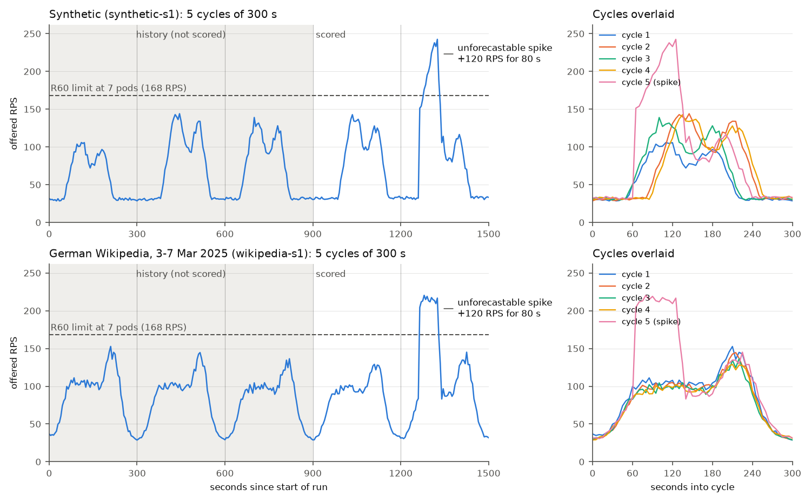
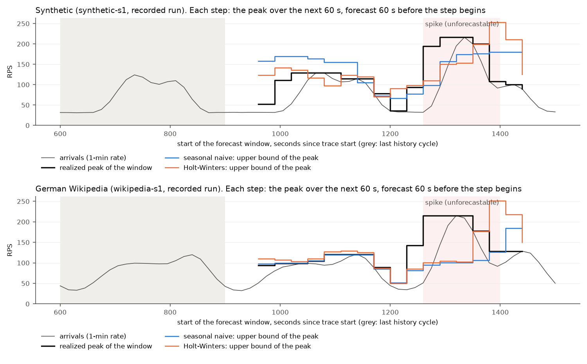
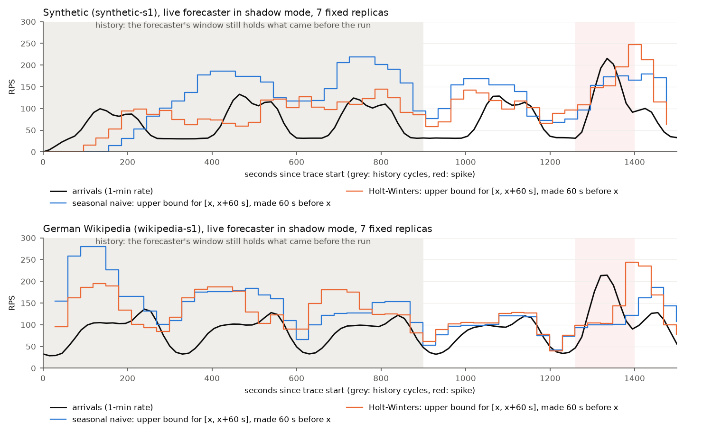

# Methodology

How the experiment's constants were measured. Every number here comes from a run whose raw
output is in `experiments/results/`; the commands to reproduce it are at the end of each
section.

## Constants

| Constant | Value | Source |
|---|---|---|
| SLO | client-side p95 < **300 ms** | fixed before calibration, kept |
| Pod resources | 500m CPU, 128Mi (request = limit) | `deploy/app/deployment.yaml` |
| `WORK_ITERATIONS` | **150000** (≈ 8.5 ms of CPU per request) | [capacity](#capacity) |
| `WORK_CONCURRENCY` | GOMAXPROCS = **2** for a 500m limit | [overload behaviour](#overload-behaviour-two-fixes) |
| Knee (1 pod) | **≈ 54 RPS** | [capacity](#capacity) |
| `RPS_PER_POD` | **40** (75 % of the knee) | [capacity](#capacity) |
| `STARTUP_DELAY_SECONDS` | 30 (swept 0/30/60 later, R6) | plan |
| Scale-up lag, step → new pod serving | **≈ 60 s measured, 60–75 s expected** | [lag](#scale-up-lag) |
| `minReplicaCount` / `maxReplicaCount` | **2 / 7** | [replica bounds](#replica-bounds) |
| Load traces | 5 cycles × 300 s (3 history, 2 scored), seeds 1–5 per workload | [load traces](#load-traces) |
| Connections | new connection per request (`noVUConnectionReuse`) | [load generation](#load-generation-one-connection-per-request) |
| `rate[1m]` delay | the arrival series trails real arrivals by **≈ 28 s** | [forecaster](#what-it-forecasts-and-how-far-ahead) |
| Forecast window | peak over **[now + 60 s, now + 120 s]** (LEAD = startup delay + 30 s) | [forecaster](#what-it-forecasts-and-how-far-ahead) |
| Forecast upper bound | one-sided **90 %** | [forecaster](#models) |

## Setup

- macOS arm64 host (4 performance + 6 efficiency cores), Docker Desktop with 10 CPUs.
- kind cluster, Kubernetes v1.37.0. The app node container is pinned to CPUs 6–9; the tools
  node and control plane share 0–5. The app node's allocatable CPU is 4.
- One app pod per measurement unless stated. k6 v2.3.0 runs **in the cluster on the tools
  node** (`loadtest/run-k6.sh`), hits `http://web.default.svc.cluster.local/work` through the
  Service, and remote-writes its metrics to Prometheus.
- Open model only: k6 `constant-arrival-rate`, so the offered rate does not slow down when
  the server does. Request timeout 10 s.
- CPU of the three kind node containers is sampled with `docker stats` during every run
  (`*.docker-stats.csv`), because CPU pinning isolates scheduling but not the hardware
  (a saturated tools node slowed the app by ~40 % in Phase 1).

## Capacity

**Method.** One pod, replicas fixed. Each step is its own k6 scenario at a constant arrival
rate: 50 s per step, the first 10 s excluded as warm-up, 20 s idle between steps so a backlog
can drain. Latency is k6's `http_req_duration` (client side, includes queueing).

**One pod** (`sweep-1pod.json`):

| offered RPS | achieved | p50 ms | p95 ms | p99 ms |
|---:|---:|---:|---:|---:|
| 40 | 40.0 | 8.5 | 9.3 | 12.3 |
| 50 | 50.0 | 8.0 | 8.6 | 12.7 |
| 54 | 54.0 | 8.2 | **322** | 381 |
| 57 | 57.0 | 7.9 | 14.7 | 57.4 |
| 60 | 58.7 | 1122 | 1896 | 1996 |
| 63 | 58.7 | 2792 | 4273 | 4520 |
| 70 | 62.1 | 4838 | 7395 | 7572 |

A 500m pod saturates at about **58–60 RPS** (achieved throughput stops rising), i.e. about
8.5 ms of CPU per request. Below that, latency is flat at ~8 ms; above it, the queue grows
without bound and p95 goes to seconds. That's the expected cliff for a CPU-capped server.

Near the cliff the result is noisy: 54 RPS crossed the SLO while 57 did not. Utilisation is
above 90 % there, so a short slowdown (macOS moving the VM's threads to an efficiency core, or
lowering clocks) builds a queue that a few seconds of slack cannot drain. Earlier sweeps
before the fixes below put the crossing at 57–60 RPS. The **knee is taken as 54 RPS**, the
lowest offered rate that has crossed the SLO in any sweep.

**`RPS_PER_POD = floor(0.75 × 53.7) = 40`**, inside the plan's 70–80 % band.

**Seven pods** (the maximum; `sweep-7pods.json`), to check that per-pod capacity holds when
the app node is busy:

| offered RPS | per pod | p50 ms | p95 ms | p99 ms |
|---:|---:|---:|---:|---:|
| 210 | 30 | 7.7 | 8.7 | 13.7 |
| 294 | 42 | 7.6 | 10.7 | 43.3 |
| 350 | 50 | 7.6 | 23.8 | 80.2 |
| 392 | 56 | 8.3 | 87.6 | 172 |
| 420 | 60 | 14.9 | 144 | 215 |

At 40 RPS per pod, seven pods have p95 ≈ 10 ms, so `RPS_PER_POD` holds at full scale.
Seven pods degrade *more gently* per pod than one. The likely cause is that with 3.5 cores
busy, macOS keeps the VM on performance cores and at high clocks, while a single busy pod can
end up on an efficiency core. **Per-pod capacity therefore depends a little on total load.**
This is a threat to validity: under-provisioned moments in a reactive arm are partly cushioned
when the node is busy. `RPS_PER_POD` is set from the more pessimistic one-pod curve.

**Load generator headroom.** k6 delivered 420 RPS with 0 dropped iterations. During the
7-pod sweep the tools node averaged 14 % of one CPU (peak 45 %), far below saturation.

Reproduce: `make calibrate` (one pod) or `./loadtest/run-k6.sh loadtest/k6/calibrate.js OUT STEPS=...`
against a fixed replica count, then `experiments/analysis/calibration.py OUT.json`.

## Overload behaviour: two fixes

The first calibration and lag runs exposed two ways the app failed under overload. Both would
have punished under-provisioned arms through artefacts rather than through latency. Raw data
from before the fixes is in `experiments/results/calibration/pre-concurrency-limit/`.

1. **Probes killed overloaded pods.** At 70 RPS on one pod, `/healthz` took longer than the
   1 s default probe timeout, the kubelet restarted the container, and for the 30 s startup
   delay the Service had no endpoints ("connection refused"). The probes now tolerate
   overload: readiness drops a pod after ~6 s unresponsive (`timeoutSeconds: 2`,
   `failureThreshold: 3`), and liveness restarts it only after ~60 s (`timeoutSeconds: 5`,
   `failureThreshold: 6`). Neither changes time-to-Ready nor draining.
2. **Overload blinded the scaler.** With no concurrency limit, an overloaded pod ran hundreds
   of CPU-burning goroutines on a 0.5-CPU quota. That starved the rest of the process: the
   accept loop, so `http_requests_received_total` stopped counting arrivals; `/metrics`, so
   scrapes timed out; and the probes. In one lag run, the arrival rate seen by Prometheus
   *fell* from 25 to 10 RPS when offered load jumped to 100, and KEDA never scaled up. The
   app now runs at most `WORK_CONCURRENCY` (default GOMAXPROCS) requests at once. The rest
   wait on a channel, which uses no CPU, and are counted *before* they wait. A queued
   request whose client gives up is dropped without being worked (status 499).
   `work_requests_queued` exposes the queue. After the fix, arrivals track offered load
   (see the timeline below) and no pod restarted in any run.

## Scale-up lag

**Method.** `loadtest/measure-lag.sh`: one pod, reactive KEDA ScaledObject on
`sum(rate(http_requests_received_total{app="web"}[1m]))` with `AverageValue` threshold 42
(the R100 configuration; minReplicaCount 1 so a step from one pod is easy to read). Before
each rep the script waits for the arrival rate to return to ~0, because a leftover
`rate[1m]` from the previous run made the HPA scale up before the step in the first attempt.
k6 holds 25 RPS for 90 s, then steps to 100 RPS. Timestamps come from:

| mark | source |
|---|---|
| step | first request of the high phase, logged by k6 |
| metric | first moment the scaler query exceeds `threshold × replicas × 1.1` (HPA tolerance), evaluated post hoc at 1 s resolution |
| decision | HPA `SuccessfulRescale` event (1 s resolution) |
| scheduled / started | pod `PodScheduled` condition / container `startedAt` |
| ready | the app's own "startup delay done, ready" log line (the kubelet notices within one 2 s probe period) |
| serving | first `/work` request logged by the new pod |

**Result** (3 reps; `lag-*.lag.json`):

| segment | rep 1 | rep 2 | rep 3 | what it is |
|---|---:|---:|---:|---|
| step → metric | 27.0 | 26.0 | 25.0 | 15 s scrape interval + `rate[1m]` ramping up to the threshold |
| metric → decision | 1.7 | 2.7 | 3.7 | wait for the HPA's next 15 s sync, which asks KEDA's metrics server, which queries Prometheus |
| decision → scheduled | 0.0 | 0.0 | 0.0 | ReplicaSet + scheduler (< 1 s) |
| scheduled → started | 1.0 | 1.0 | 1.0 | image already on the node |
| started → ready | 30.2 | 30.2 | 30.2 | `STARTUP_DELAY_SECONDS` |
| ready → serving | 0.9 | 0.4 | 1.0 | probe + endpoint propagation |
| **step → serving** | **60.8** | **60.3** | **60.9** | |

*The "ready pods" line comes from kube-state-metrics and trails the pod's own log by a scrape
interval.*

Notes:

- **The metric → decision spread is underestimated.** The reps started exactly 5 min apart,
  a multiple of the 15 s HPA sync period, so every step landed at the same phase of the sync
  cycle. In general this segment is anywhere in 0–15 s, which makes the **expected end-to-end
  lag 60–75 s**. The forecaster's lead time should therefore be at least 75 s plus a margin
  (Phase 4).
- **step → metric depends on the step size and the threshold.** It is the time for a 1-minute
  rate to climb past the threshold, so bigger steps are detected faster. At the final
  `RPS_PER_POD = 40` this step crosses about 2 s earlier than at the 42 used here.
- **KEDA's `pollingInterval` doesn't matter here.** KEDA 2.21 warns that it only affects
  scaling to or from zero (or with cached metrics). From 1 to N replicas, the HPA's 15 s sync
  sets the cadence. The arms' ScaledObjects can drop it.
- **Scaling up is stepwise.** The first decision went to 2 pods, because the 1-minute rate
  was still climbing. 3 pods needed the rate above 2 × 42 × 1.1 = 92.4, which a 100 RPS step
  hovers around, and took another 90 s.
- **Keep-alive pins load to old pods.** After the new pod was ready, the old pod still took
  ~64 RPS and the new one ~36. kube-proxy balances *connections*, and k6 VUs keep theirs, so
  only new connections reach new pods. This affects how fast a scale-up relieves overload and
  is a decision for Phase 3 (see below).

Reproduce: `make lag RPS_PER_POD=42` (one rep), then
`experiments/analysis/lag_timeline.py OUT.lag.json OUT` for the plot.

## Replica bounds

- App node allocatable: 4000m CPU. kindnet requests 100m, which leaves 3900m and room for
  **7 pods** of 500m. `maxReplicaCount = 7`.
- `minReplicaCount = 2` (plan), i.e. 80 RPS of capacity at `RPS_PER_POD`.

## Load traces

`loadtest/trace/generate.py` writes a trace: the offered RPS every 5 s, which
`loadtest/k6/trace.js` replays with one `ramping-arrival-rate` stage per point (k6 ramps
linearly between them). It is deterministic: the same seed always gives the same file, so
every arm sees exactly the same load. Seeds 1–5 of both workloads are committed in
`loadtest/trace/out/`, and a test checks that they match the generator.

**Run structure.** Five cycles of 300 s (25 min). Each cycle is a compressed day. The first
three are history: the forecaster learns from them and they are not scored. The last two are
scored, and an unforecastable spike falls in the last one, so no later scored cycle ever has
it in its history.

**Synthetic workload.** A fixed daily shape (night baseline, morning ramp, peak, midday dip,
second peak, evening ramp down), with each cycle varied so that "same as yesterday" is never
the exact answer (plan revision R2):

| Parameter | Default | Why |
|---|---|---|
| Base / nominal peak | 30 / 120 RPS | the base fits within `minReplicaCount` 2 (80 RPS) |
| Amplitude | peak height above base × U(0.8, 1.2) per cycle | varies the peak |
| Timing | shape shifted by U(−0.1, 0.1) × cycle, i.e. ±30 s | varies when the ramp starts |
| Trend | level +10 % over the run | something a seasonal copy misses |
| Noise | × (1 + 0.04 z), z ~ N(0,1) clipped at ±2, every 5 s | short-term jitter |

The night baseline covers both ends of each cycle with 0.1 of a cycle to spare, so the timing
shift never moves load across a cycle boundary.

**Real workload.** Hourly pageviews of German Wikipedia (Wikimedia REST API, `user` agent,
all access), 3–7 March 2025 (Monday to Friday). The raw response is committed in
`loadtest/trace/raw/`. Transformation:

1. One real day becomes one 300 s cycle (1 hour = 12.5 s). Cycles start at 03:00 UTC, the
   daily trough, so cycle boundaries fall at the baseline as in the synthetic shape.
2. Each hourly count is placed at the middle of its hour; points in between are linear
   interpolation.
3. The 5-day minimum maps to 30 RPS and the maximum to 150 RPS (affine). The real ratio is
   about 10× (night to evening peak); keeping it would need a night rate below what two pods
   are for.
4. The same noise and spike as the synthetic trace are added.

German rather than English Wikipedia: almost all of its readers share one time zone, so it
has a clear daily cycle (about 10× from trough to peak), while English Wikipedia's global
audience flattens its cycle to 1.6×. English Wikipedia's 3 March also has a one-off peak from
the Oscars.

**How predictable each workload is.** On the noise-free scored cycles, a forecast of "same as
the previous cycle" has an sMAPE of **10–38 %** on synthetic seeds 1–3 and **2–5 %** on the
Wikipedia week (5–7 % if the window ends on a Saturday). Real daily traffic is very regular.
The two workloads are therefore an easy realistic case and a hard varied case, and the
results will be reported per workload. Prediction winning only on Wikipedia would be a
different finding from winning on both.

**The spike.** +120 RPS on top of the trace for 80 s (5 s rise, 60 s hold, 15 s fall), placed
at a seeded position in the last cycle. Its position depends on the seed only, so seed N has
the same spike in both workloads.

**Constraints from Phase 2, checked by the generator:**

- **R60 must fit.** R60 targets 0.6 × 40 = 24 RPS per pod, so a peak of P needs
  ceil(P / 24) ≤ 7 pods: **P ≤ 168 RPS**, including amplitude, trend and noise. The generator
  fails (it never clips) if a point outside the spike exceeds it. Seeds 1–5 peak at 142–159
  RPS (synthetic) and 146–161 RPS (Wikipedia).
- **Ramps must outrun R100.** A pod at `RPS_PER_POD` has 54 − 40 = 14 RPS of headroom before
  the knee. With n pods and ~60–75 s of lag, a ramp steeper than about 14 n / 60 RPS/s
  outruns reactive scaling: 0.47 RPS/s at 2 pods, 0.7 at 3. The steepest 60 s rise of the
  noise-free level is **1.8–1.9 RPS/s** (synthetic) and **1.1 RPS/s** (Wikipedia), 1.6–4×
  steeper.
- **The spike** may exceed what R60 can provision (seeds 1–5 reach 220–264 RPS); it stays
  below what 7 pods can serve (7 × ~54 ≈ 380 RPS).

## Load generation: one connection per request

kube-proxy balances **connections**, not requests. With keep-alive, k6's VUs stay on the
pods that existed when their connections opened: after a scale-up in Phase 2, the old pod
kept about 64 RPS and the new one got about 36. Traffic from many independent clients, or
through an L7 load balancer, spreads per request instead. `trace.js` therefore sets
`noVUConnectionReuse: true` for every arm, so each request opens a new connection and lands
on a random ready pod. On a 2-minute smoke run at 7 pods, each pod's share was within 10 % of
the busiest's.

Consequences, measured:

- **Capacity is unchanged.** A 1-pod sweep without connection reuse
  (`sweep-1pod-noreuse.json`, the purple curve above) crosses the SLO between 54 and 57 RPS
  (interpolated 54.6), the same knee. `RPS_PER_POD` stays 40. CPU per request rose from
  ~8.5 ms to ~8.7 ms.
- **The tail is fatter near the knee.** Per-pod arrivals are random rather than smooth, so a
  pod sometimes gets several requests at once and exhausts its 50 ms of CPU per 100 ms CFS
  period. In the 1-pod sweep, p99 at 50–54 RPS was 85–105 ms (13 ms with reuse).
- **Ports.** Each request leaves a socket in TIME_WAIT for 60 s, all to one Service IP and
  port. `run-k6.sh` widens the k6 pod's local port range (a namespaced "safe" sysctl) to
  1024–65535, which allows ~1000 new connections/s; the traces need at most ~265.

## Trace replay check

Each workload's seed-1 trace was replayed against **7 fixed replicas, no scaler**
(`make trace-check`), to check that k6 delivers the trace and the app keeps up at maximum
scale. Results in `experiments/results/traces/`.

| Trace | offered | sent | dropped | failed | p95 overall | p95 / p99 in the spike | tools node CPU, mean / max |
|---|---:|---:|---:|---:|---:|---:|---:|
| synthetic-s1 | 109,237 | 109,237 | 0 | 0 | 9.4 ms | 10.3 / 31.0 ms | 10 % / 57 % of a CPU |
| wikipedia-s1 | 133,533 | 133,532 | 0 | 0 | 9.0 ms | 9.0 / 26.6 ms | 12 % / 66 % of a CPU ¹ |

Per cycle, sent / offered was at least 0.9999 in both runs, and nothing was dropped or
failed. (The synthetic run still had 100 pre-allocated VUs and never needed more.) The load generator is not the bottleneck: the tools node stayed far from
saturation.

¹ One sample of 258 % at 1491 s, as k6 finished and built its summary; every other sample
was below 67 %.

A first Wikipedia run with 100 pre-allocated VUs (`check-wikipedia-s1-prealloc100.*`)
dropped 7 of 133,533 requests: k6 needed 102 VUs, and starting VUs mid-run is slow enough to
miss a few scheduled iterations. Its spike also had p95 / p99 of 30 / 294 ms, with 12 % of
CFS periods throttled on the web pods at ~31 RPS per pod. The re-run with 200 pre-allocated
VUs had neither, so the tail was mostly run-to-run noise (laptop scheduling) on top of the
burstiness described above. `trace.js` now pre-allocates 200 VUs.

Reproduce: `make traces`, then `make trace-check TRACE=synthetic-s1` (25 min).

## Forecaster

`forecaster/` (Python, deployed by `make forecaster-deploy` to the tools node). Every 30 s it:

1. reads `sum(rate(http_requests_received_total{app="web"}[1m]))` from Prometheus
   (`query_range`, 15 s steps, the last 3 cycles plus one forecast window for scoring);
2. fits each model on up to 3 cycles (60 samples);
3. exports the **peak over the window [now + 60 s, now + 120 s]**, both the point forecast
   and a one-sided 90 % upper bound. KEDA scales arms C and D on the upper bound.

It runs in every arm (shadow mode), and both models are exported in every run, so forecast
quality is measured everywhere regardless of which model a scaler reads.

### What it forecasts, and how far ahead

**The series lags real arrivals by about 28 s.** The forecaster reads the same 1-minute rate
as the reactive trigger. The rate at time T is the counter increase between the first and
last 15 s scrape inside [T − 60, T], so it averages arrivals over roughly [T − 50, T − 5].
Fitting this against the two recorded trace-check runs gives exactly that: a 45 s trailing
mean ending 5–6 s before T matches the recorded series to within 1 %. The series therefore
trails real arrivals by about 28 s.

**The forecast path is faster than the reactive one.** From a forecast computed at t to a new
pod serving:

| segment | seconds | source |
|---|---:|---|
| Prometheus scrapes the forecaster | 0–15 | scrape interval |
| HPA sync asks KEDA, which queries Prometheus | 0–15 | HPA sync period |
| decision → new pod serving | ≈ 32 | Phase 2: 1 s scheduling and start, 30.2 s startup delay, ~1 s to serve |
| **total** | **32–62** | |

The reactive path's 60–75 s includes ~27 s for the rate to climb past the threshold. The
forecast path skips that.

**The window.** The next forecast comes 30 s later, so each forecast must cover the load
from t + 32 s (best case) to t + 92 s (worst case, plus one interval) in real time. On the
lagged series that is about [t + 60, t + 120]: **LEAD = 60 s, WINDOW = 60 s**. In general,
LEAD = `STARTUP_DELAY_SECONDS` + 30 s, so the lag sweep (startup delay 0 and 60 s, Phase 6)
uses LEAD 30 and 90 s. The end of the window matters less than its start: once the HPA has
scaled up, its 120 s scale-down stabilization keeps the pods for two more minutes.

### Models

Both implement one interface (`forecaster/src/forecaster/models/`), and the service and the
backtest call the same code (`window.predict`).

- **Seasonal naive.** The point forecast is the value one cycle (300 s) earlier. The upper
  bound adds the 90th percentile of the history's seasonal differences y[t] − y[t − 300 s],
  i.e. of the errors this forecast made in the past. That needs two cycles of history, and
  the bound is only ever raised, never lowered below the point forecast.
- **Holt-Winters**: ETS(A,N,A) from statsmodels 0.15 (`ETSModel`), additive error, no trend,
  additive seasonality with a period of 20 samples (300 s / 15 s), estimated initial states,
  analytic prediction intervals. No trend term: three cycles are too short to estimate one,
  and over a two-minute horizon the level update follows slow drift anyway.

**Holt-Winters on three cycles** (plan: "check statsmodels copes"):

- It fits without warnings. A fit takes **24–38 ms** (median per series).
- **The fit degenerates.** Over 54 backtest fits, the optimiser always puts the level
  smoothing at its upper bound (α = 1.0) and the seasonal smoothing at its lower bound
  (γ ≈ 0, at most 0.0001). The 1-minute rate is smooth, so the best one-step predictor is the
  last value, and with γ = 0 the seasonal profile stays at its initial estimate. The forecast
  is therefore "the latest value plus the change the seasonal profile expects over the next
  two minutes". Its intervals grow like a random walk's, from one-step residuals. Those are
  too narrow four to nine steps ahead on an autocorrelated series, which shows up as low
  coverage below.
- statsmodels 0.15's `get_prediction` fails on a bare NumPy array (`'numpy.ndarray' object
  has no attribute 'index'`), so the model passes a pandas Series.

### Failure behaviour

A made-up number is never exported. When the forecaster has nothing valid, the series is
absent, so arm D's reactive trigger decides alone, and arm C falls back to KEDA's `fallback`
(Phase 5).

| situation | what is exported |
|---|---|
| less than 2 cycles of history, or no arrival series at all (cold start) | no `forecast_rps` for that model |
| Prometheus query fails | the last good forecast, until its window has passed (120 s after it was made), then nothing. `forecast_last_success_timestamp_seconds` stops advancing |
| a model's fit fails | the same, for that model only. The other model is unaffected |
| gaps in the history | gaps of up to 2 samples are interpolated. A longer gap cuts the history there |
| an absurd forecast | clamped to [0, 7 × 40 = 280] RPS. No lower clamp: `minReplicaCount` already sets the floor, and a floor here would hide the shape |

Exported metrics: `forecast_rps{model, bound="upper"|"mean"}`,
`forecast_last_success_timestamp_seconds{model}`, `forecast_fit_duration_seconds{model}`,
`forecast_smape{model}` and `forecast_coverage_ratio{model}` (over the last 10 forecasts
whose window has since been observed), `forecast_errors_total{stage, model}`,
`forecast_history_seconds`, and the configuration (`forecast_lead_seconds`,
`forecast_window_seconds`, `forecast_upper_quantile`). The Grafana dashboard
"Predictive autoscaling: forecast" (`deploy/forecaster/dashboard.yaml`) plots them.

### Backtest

`make backtest` (`forecaster/backtest/backtest.py`) runs a rolling-origin evaluation.

**Series.** Ten simulated arrival series and the two recorded ones.

- **Simulated**: one per committed trace (seeds 1–5 × 2 workloads), as Prometheus would
  record it. Poisson arrivals at the trace's rate over 7 pods, each pod's counter scraped
  every 15 s at its own phase, read as `sum(rate(...[1m]))`. Against the two recorded runs
  the simulation differs by 3.3 % on average (mean absolute, no bias), about the Poisson
  noise of a 45 s count at 100 RPS.
- **Recorded**: the series from the two trace-check runs
  (`experiments/results/traces/check-*-s1.arrivals.json`).

**Method.**

- **Origins:** every 30 s through the scored cycles. At each origin a model is fitted on the
  preceding 3 cycles and forecasts the window [origin + 60 s, origin + 120 s].
- **Spike windows:** windows overlapping the spike (or the minute after it) are reported
  separately.
- **Scoring:** "peak" is the realized maximum of the series over the window. "Short" is the
  share of windows where the upper bound implies fewer pods than the realized peak needs,
  with pods = ceil(rps / 40) clamped to [2, 7]. "Current" is a reference rather than a model:
  the latest value of the series, which is what a reactive scaler acts on (without its own
  detection delay).

Results (`experiments/results/backtest/`):

| workload | model | windows | peak sMAPE | MASE | 90 % bound covers | short of pods | extra pods | spike windows covered |
|---|---|---:|---:|---:|---:|---:|---:|---:|
| synthetic | seasonal naive | 55 | 21.9 % | 1.33 | 85 % | 4 % | +0.69 | 17 % of 30 |
| synthetic | Holt-Winters | 55 | 21.1 % | 1.15 | 75 % | 5 % | +0.29 | 23 % of 30 |
| synthetic | *current (reference)* | 55 | 66.5 % | 3.57 | 40 % | 42 % | −0.36 | 13 % of 30 |
| Wikipedia | seasonal naive | 55 | 2.8 % | 0.73 | 78 % | 5 % | +0.09 | 13 % of 30 |
| Wikipedia | Holt-Winters | 55 | 5.9 % | 1.54 | 89 % | 0 % | +0.16 | 17 % of 30 |
| Wikipedia | *current (reference)* | 55 | 45.9 % | 9.45 | 24 % | 64 % | −0.47 | 10 % of 30 |

*Simulated series, seeds 1–5. The recorded runs (10 windows each, `backtest.md`) agree in
direction: synthetic sMAPE 29 % for both models, Wikipedia 2.5 % (naive) vs 7.0 %
(Holt-Winters).*

What it shows:

- **Forecasting at this lead is necessary.** Acting on the current rate would be short of
  pods in 42 % (synthetic) and 64 % (Wikipedia) of windows, against at most 5 % for either
  model. A reactive scaler sees the current rate later still, which is the case for
  prediction.
- **Synthetic: no clear winner.** Peak sMAPE is the same (21–22 %). Holt-Winters has the
  lower MASE (1.15 vs 1.33) and costs fewer extra pods (+0.29 vs +0.69). But its "90 %" bound
  covers only 75 % of windows (naive: 85 %), and it is short of pods about as often (5 % vs
  4 %). Neither beats the in-sample naive error (MASE > 1). The timing and amplitude
  variation is what makes this workload hard, by design.
- **Wikipedia: seasonal naive wins clearly** (2.8 % vs 5.9 % sMAPE, MASE 0.73 vs 1.54). Real
  days repeat closely, and Holt-Winters' random-walk level only adds noise to a good seasonal
  copy.
- **The spike is not forecast** (10–23 % of its windows covered), as designed. Afterwards
  both models overshoot for a while: the spike has entered Holt-Winters' level and naive's
  error quantile (visible after 1350 s in the figure).
- **Caveat:** the 55 windows per workload come from 5 seeds with overlapping windows every
  30 s, so they are not independent. Differences of a few percent are within noise.

### Shadow-mode replay

**Setup.** The deployed forecaster ran while each seed-1 trace was replayed against 7 fixed
replicas with no scaler (`make trace-check`, results in `experiments/results/forecaster/`).
k6 delivered both traces in full: 109,236 of 109,237 and 133,532 of 133,533 requests, none
dropped or failed, p95 9.6 and 9.3 ms. The forecaster used about 108 MiB of memory (limit
256 MiB) and about 0.01 CPU.

**Scoring.** `experiments/analysis/forecast_shadow.py` saves the run's series from
Prometheus (`*.series.json`, so the analysis reruns without the cluster). It then scores each
forecast made in the scored cycles against the samples its own window covered, the same way
as the backtest.

| trace | model | windows | peak sMAPE | 90 % bound covers | short of pods | backtest, same recorded trace |
|---|---|---:|---:|---:|---:|---:|
| synthetic-s1 | seasonal naive | 9 | 30.3 % | 89 % | 0 % | 29.4 % |
| synthetic-s1 | Holt-Winters | 9 | 30.8 % | 67 % | 11 % | 29.1 % |
| wikipedia-s1 | seasonal naive | 10 | 2.5 % | 80 % | 10 % | 2.5 % |
| wikipedia-s1 | Holt-Winters | 10 | 9.5 % | 80 % | 0 % | 7.0 % |

**Result.** The live forecaster reproduces the backtest within the noise of 9–10 windows, and
`forecast_rps` follows the load shape (below, and in the Grafana dashboard).

Notes:

- **Score on the forecaster's own grid.** The forecaster samples at multiples of 15 s since
  the epoch, while the trace starts mid-step. Scoring a forecast against the trace-aligned
  series, whose samples sit 5 s off, first made Wikipedia naive look twice as bad (5–7 %):
  on the steep evening drop, a sample 5 s earlier changes the realized peak by up to 20 RPS.
- **Don't score the value at time t against [t + 60, t + 120].** A value Prometheus holds at
  t can be up to 45 s old (30 s interval + 15 s scrape). LEAD already allows for that, so
  scoring that way counts the delay twice.
- **During the history cycles, forecasts reflect what came before the run.** In the
  Wikipedia replay, which started right after the synthetic one, the first forecasts hit the
  280 RPS clamp. From the first scored cycle on, the 3-cycle window holds only the run itself.
  In arm C this means scaling in the history cycles is driven by the previous run's tail.
  That is harmless for scoring, but Phase 6's cool-down must leave the replica count at the
  minimum before a run starts.

Reproduce: `make forecaster-deploy`, then
`make trace-check TRACE=synthetic-s1 TRACE_OUT=experiments/results/forecaster/shadow-synthetic-s1`
with Prometheus port-forwarded, then
`.venv/bin/python experiments/analysis/forecast_shadow.py experiments/results/forecaster/shadow-synthetic-s1 --plot ...`.

### Open decision: the model for arms C and D

The plan's example uses Holt-Winters. The backtest does not favour it. It ties with seasonal
naive on the synthetic workload, loses on Wikipedia, and its upper bound is miscalibrated.
The options are seasonal naive (simpler, as good or better), Holt-Winters (as planned), or
both (C and D run once per model, doubling those runs). Both models are exported in shadow
mode either way.
