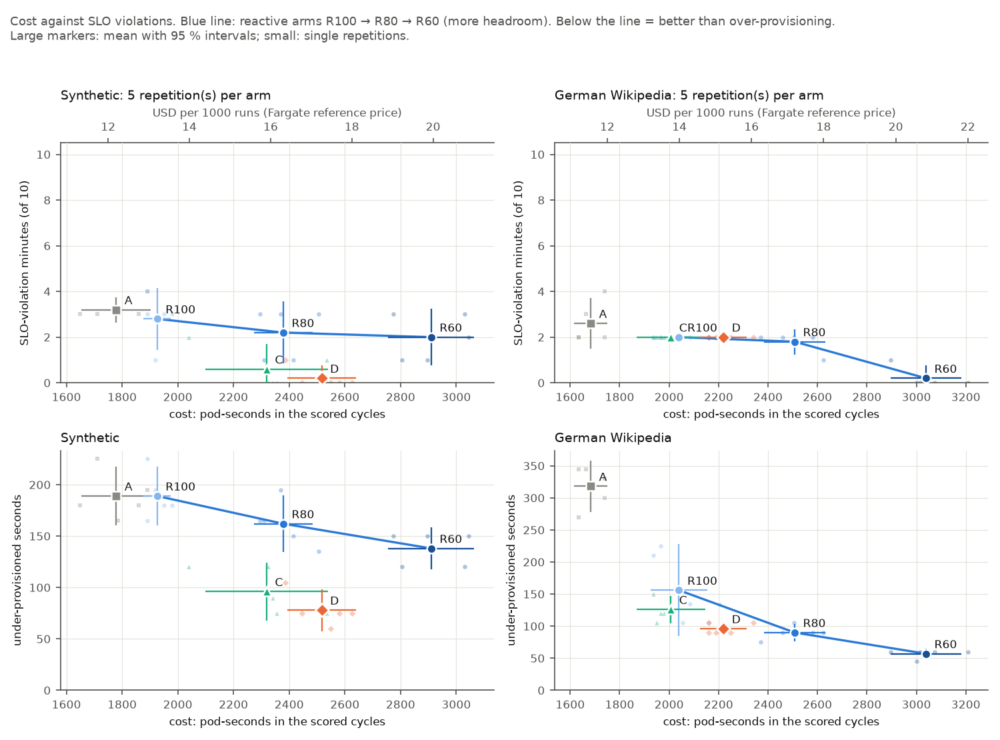
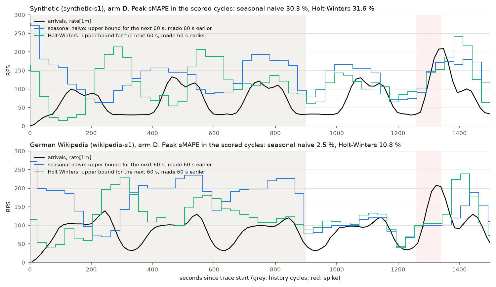
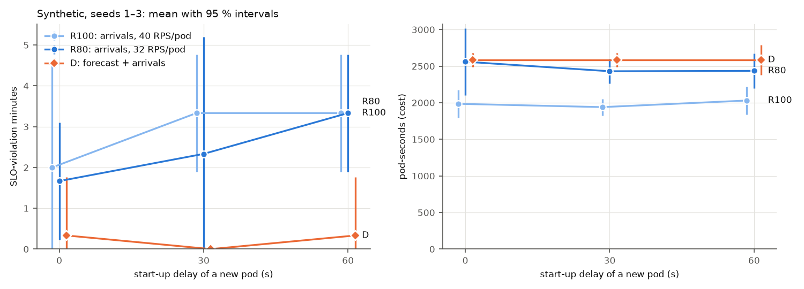
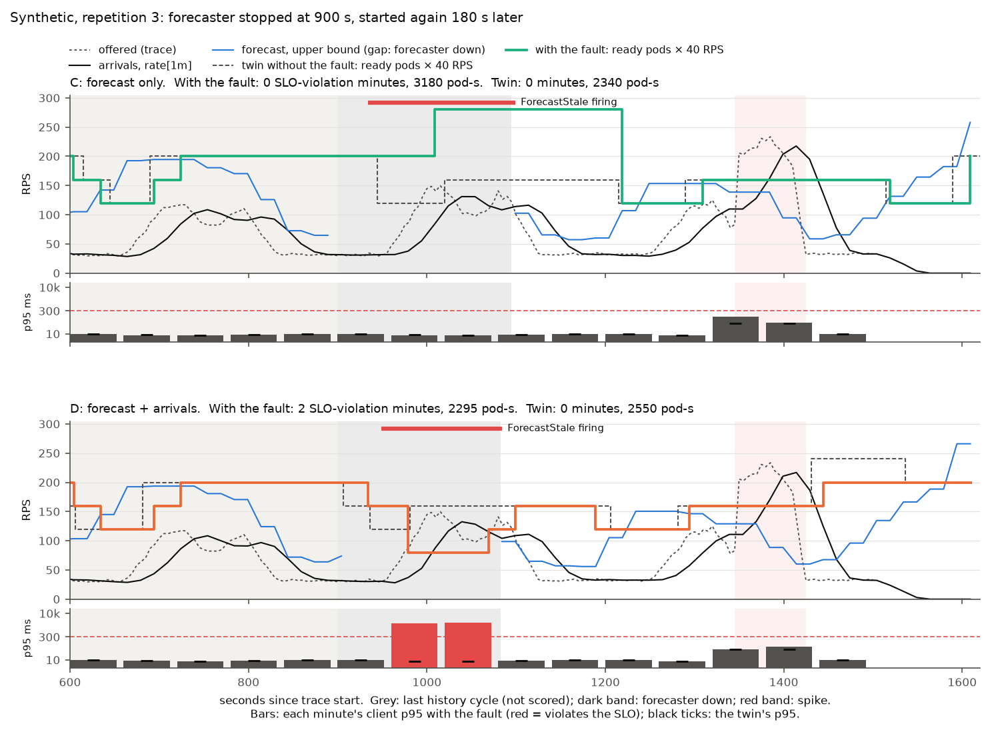

# Results

What the 90 runs showed. The design, the fairness controls and the threats to validity are in
[methodology.md](methodology.md). Every number here is generated by `make analyze` from the
raw runs in `experiments/results/`; the full tables, with the number of runs behind each
value, are in [results-tables.md](results-tables.md). Values are means ± the half-width of the
95 % Student-t interval. "Below" or "above" means the interval excludes zero; otherwise a
difference is within noise.

## Summary

- **On the synthetic workload, prediction beat over-provisioning.** D, the forecast and the
  arrival rate together, averaged 0.2 SLO-violation minutes per run (1 of its 50 scored
  minutes). R100 averaged 2.8, and R60, the most generous reactive arm, 2.0. D also used 14 %
  fewer pod-seconds than R60. Against the frontier, at its own cost, D
  had 1.95 ± 1.70 fewer violation minutes.
- **On German Wikipedia, it bought nothing that headroom would not.** Reactive scaling
  already kept up with the gentle daily pattern, and the only violations were the spike's,
  which no forecast sees. D lies on the frontier.
- **Accuracy was not what mattered.** The forecasts were six times more accurate on Wikipedia
  (3.2 % against 20.9 % peak sMAPE), yet the benefit appeared only on the synthetic workload,
  where the reactive lag actually cost minutes. Both hypotheses that expected the opposite
  failed.
- **Slower pods, more benefit.** With pods that start instantly, D's advantage over R100 was
  within noise. At 30 and 60 s start-up, it was clear.
- **When the forecaster dies,** D becomes the reactive autoscaler it contains, at no extra
  cost. The forecast-only arm C holds the SLO through its fallback to the maximum replica
  count, at 40 % more pod-seconds.

## Evaluation: six autoscalers on two workloads

All 60 runs of the main grid and all 18 of the start-up delay sweep finished. Every run was
checked for the one failure a run's own status can't show, the host sleeping mid-run:
- each took 1620–1621 s from first request to end of tail;
- each saved series has all 113 samples at 15 s spacing;
- none ran on a modified working tree.

One sweep run failed this check and was repeated.

| Arm | Synthetic: violation min | spike min | pod-s | Wikipedia: violation min | spike min | pod-s |
|---|---:|---:|---:|---:|---:|---:|
| A: HPA on CPU | 3.2 ± 0.6 | 2.0 ± 0.0 | 1779 ± 125 | 2.6 ± 1.1 | 2.4 ± 0.7 | 1683 ± 66 |
| R100 | 2.8 ± 1.4 | 1.6 ± 1.1 | 1926 ± 49 | 2.0 ± 0.0 | 2.0 ± 0.0 | 2040 ± 113 |
| R80 | 2.2 ± 1.4 | 1.2 ± 1.0 | 2379 ± 106 | 1.8 ± 0.6 | 1.8 ± 0.6 | 2508 ± 125 |
| R60 | 2.0 ± 1.2 | 1.0 ± 1.2 | 2910 ± 155 | 0.2 ± 0.6 | 0.2 ± 0.6 | 3039 ± 143 |
| C: forecast only | 0.6 ± 1.1 | 0.6 ± 1.1 | 2319 ± 221 | 2.0 ± 0.0 | 2.0 ± 0.0 | 2007 ± 139 |
| **D: forecast + arrivals** | **0.2 ± 0.6** | 0.2 ± 0.6 | 2517 ± 123 | 2.0 ± 0.0 | 2.0 ± 0.0 | 2220 ± 95 |

n = 5 per cell, 10 scored minutes per run. "Spike min" counts the violation minutes that
overlap the spike. A "± 0.0" means all five repetitions gave the same count.

### Synthetic workload

- **The reactive frontier is flat.** From R100 to R60, 51 % more pod-seconds bought 0.8
  fewer violation minutes, and R60 still violated the SLO in two of ten minutes. About one of
  those minutes, in every reactive arm, lies on a ramp of the daily pattern rather than in the
  spike.
- **The forecast-driven arms remove the ramp minutes.** C and D had no violation outside the
  spike in any repetition. D failed no request, and its p95 was 62 ± 59 ms, against several
  seconds in every reactive arm.
- **Paired within a repetition, D beat R100 and R60.** It had 2.6 ± 1.9 fewer violation
  minutes than R100, at 591 ± 106 more pod-seconds. It had 1.8 ± 1.6 fewer than R60, at
  393 ± 114 *fewer* pod-seconds: better than the most generous reactive arm on both axes.

### The frontier test

Each arm is measured against the reactive frontier of its own repetition, at its own cost:

| Workload | Arm | gap, violation minutes | | gap, under-provisioned s | |
|---|---|---:|---|---:|---|
| Synthetic | A | +0.40 ± 1.11 | within noise | 0 ± 29 | within noise |
| | C | −1.69 ± 2.06 | within noise | −71 ± 34 | **below** |
| | D | −1.95 ± 1.70 | **below** | −79 ± 35 | **below** |
| Wikipedia | A | +0.60 ± 1.11 | within noise | +162 ± 75 | above |
| | C | 0.00 ± 0.00 | within noise | −29 ± 88 | within noise |
| | D | +0.07 ± 0.19 | within noise | −33 ± 41 | within noise |

On the synthetic workload, D is below the frontier on both measures. C's mean gap is almost
as large, but it varies more between repetitions, and its interval crosses zero.

### German Wikipedia

- **Only the spike violated.** R100, C and D each violated the SLO in exactly two minutes in
  every repetition, and both were spike minutes. Outside the spike, reactive scaling at full
  target kept up, and prediction had nothing left to fix.
- **Only headroom absorbs the spike.** R60 met the SLO in all but one of 50 minutes, at 49 %
  more pod-seconds than R100.
- **D lies on the frontier.** It cost 180 ± 56 pod-seconds more than R100 for the same
  violations. C was the cheapest of the three at the same violations.

### Arm A, the CPU-based HPA

A was the cheapest arm on both workloads, and its violation minutes were within noise of
R100's. The minute count understates its behaviour on Wikipedia, though:
- it was under-provisioned for 162 ± 75 s longer than R100;
- it failed 7.6 % of all requests, and 29 % of the spike's, where R100 failed none.

That fits the mechanism expected before the runs: CPU utilization can't exceed 100 % of the
request, so each HPA decision can raise the replica count by at most a factor of
1/0.7 ≈ 1.43, however large the overload. The cap itself wasn't isolated.

### Latency, stability and noise

- **p95 and p99 stop separating arms under overload.** k6 times a request out after 10 s, so
  both saturate there. Violation minutes and the share of bad requests don't.
- **More headroom made the reactive arms less stable.** R60 changed its replica count
  11.4 ± 1.9 times in ten minutes on the synthetic workload, against 5.2 ± 1.4 for D.
- **The load generator was never the bottleneck.** The tools node ran at a median 7 % of one
  core in every run, with a maximum of 258 %, out of six cores.

### Forecasts in the cluster

The forecaster runs in shadow mode in every arm, so all 30 runs per workload score both
models. Live accuracy matched the backtest within about one percentage point of sMAPE.

| Workload | Model | peak sMAPE | 90 % bound covers | short of pods | backtest sMAPE |
|---|---|---:|---:|---:|---:|
| Synthetic | seasonal naive | 20.9 ± 3.0 % | 90 ± 3 % | 1 ± 1 % | 21.9 % |
| Synthetic | Holt-Winters | 21.8 ± 2.0 % | 78 ± 5 % | 4 ± 2 % | 21.1 % |
| Wikipedia | seasonal naive | 3.2 ± 0.4 % | 73 ± 5 % | 3 ± 2 % | 2.8 % |
| Wikipedia | Holt-Winters | 6.2 ± 0.7 % | 87 ± 3 % | 0 ± 1 % | 5.9 % |

Seasonal naive, the model C and D scale on, was as good as Holt-Winters on the synthetic
workload and twice as accurate on Wikipedia.

### Start-up delay sweep

The sweep varies how long a new pod takes to serve: synthetic workload, seeds 1–3, so n = 3
per cell. The 30 s cells come from the main grid.

| Start-up delay | R100 | R80 | D | D − R100 | D − R80 |
|---|---:|---:|---:|---:|---:|
| 0 s | 2.0 ± 2.5 | 1.7 ± 1.4 | 0.3 ± 1.4 | −1.67 ± 2.87 | −1.33 ± 2.87 |
| 30 s | 3.3 ± 1.4 | 2.3 ± 2.9 | 0.0 ± 0.0 | **−3.33 ± 1.43** | −2.33 ± 2.87 |
| 60 s | 3.3 ± 1.4 | 3.3 ± 1.4 | 0.3 ± 1.4 | **−3.00 ± 2.48** | **−3.00 ± 2.48** |

SLO-violation minutes, with paired differences; bold where the interval is entirely below zero.

D stayed at 0–0.3 violation minutes at every delay, while the reactive arms got worse as pods
became slower to start. D's advantage over R100 is within noise at 0 s and clear at 30 and
60 s. It didn't grow from 30 to 60 s, though, and with three seeds per cell the trend is
suggestive rather than shown. Costs didn't move with the delay.

### When prediction paid

- **Prediction paid where reactive scaling fell behind the load, not where the load was
  easiest to forecast.**
  - On Wikipedia, R100 had no violation outside the spike in any repetition, so earlier
    scaling had nothing to win.
  - On the synthetic workload, every reactive arm lost about a minute per run on a ramp, even
    with 40 % headroom, and both forecast-driven arms lost none.
  - A forecast has to be good enough to provision ahead of the ramp, which a 21 % error with
    a 90 % bound was. Beyond that, accuracy bought nothing measurable.
- **Headroom, not prediction, is the answer to the unforeseeable.** No forecast saw the
  spike.
  - On the synthetic workload, D also lost fewer spike minutes than R100 (0.2 against 1.6,
    within noise when paired). Most likely that's because its upper bound already held about
    one pod more than R100 when the spike arrived.
  - Part of D's gain is therefore headroom placed where the forecast expects load. The
    frontier test credits D only for what the same headroom spread evenly would not have
    bought.
- **The reactive trigger in D is cheap insurance.** C and D were within noise of each other
  in violation minutes, and C was about 200 pod-seconds cheaper. D pays that for a scaler
  that keeps working when the forecaster doesn't, which the
  [fault runs](#fault-the-forecaster-dies-under-load) confirm.

### Hypotheses

These were written down before any autoscaling run.

| | Hypothesis | Outcome |
|---|---|---|
| H1 | On Wikipedia, D lies below the frontier, because its forecast error is small. | **Not supported.** On the frontier (gap +0.07 ± 0.19); no non-spike violation to remove. |
| H2 | On synthetic, the advantage is smaller, maybe within noise (22 % forecast error). | **Not supported, the opposite.** This is where D is clearly below the frontier (−1.95 ± 1.70). |
| H3 | C does no better than R100 in the spike; D's reactive trigger limits its damage to R100's. | **Supported, within noise.** C lost as many spike minutes as R100 on Wikipedia and a non-significant 1.0 ± 2.2 fewer on synthetic. D lost no more than R100 in 9 of 10 repetitions; in the tenth (synthetic, seed 5) it lost one where R100 lost none. |
| H4 | D's advantage shrinks at 0 s start-up delay and grows at 60 s. | **Partly supported.** Within noise at 0 s, clear at 30 and 60 s, but no growth from 30 to 60 s. |
| H5 | A reacts more slowly than R100 under overload (CPU utilization is capped). | **Partly supported.** Longer under-provisioned and more failed requests on Wikipedia; violation minutes within noise; the cap itself not isolated. |

## Fault: the forecaster dies under load

**Question.** If the forecaster disappears in the middle of a day, does the service stay
healthy, and what does it cost?

### Setup

- **Fault.** The forecaster Deployment is scaled to 0 at trace second 900, the start of the
  first scored cycle, before that cycle's ramp. It is started again 180 s later. Its pod was
  gone 2 s after the kill in every run. The restarted forecaster reads its history back from
  Prometheus, so it forecast again 3–17 s after the restart, with no warm-up.
- **Arms.** The two that scale on the forecast:
  - **C (forecast only).** With the forecast missing, KEDA's query fails. After three
    failures in a row, KEDA's `fallback` sets 7 pods, the maximum.
  - **D (forecast + request rate).** A missing forecast reads as 0, so the request-rate
    trigger decides alone. No fallback is configured.
- **Runs.** C and D × synthetic and German Wikipedia × seeds 1–3, so 12 runs at a start-up
  delay of 30 s. Each fault run is paired with its *twin*: the main-grid run of the same
  trace and arm, without the fault. The numbers below are fault run minus twin: the mean
  ± the half-width of the 95 % Student-t interval, n = 3 per workload and 6 for both.
- **The guard.** The `ForecastStale` alert in
  [`deploy/forecaster/alerts.yaml`](../deploy/forecaster/alerts.yaml) fires when there has
  been no successful forecast for 60 s, or no forecaster metrics at all, for 15 s. Every run
  saves the alert's state.
- **Reproduce.** Run `make experiment GRID=fault`, then `make analyze`. The raw data is in
  `experiments/results/fault/`, and the generated tables are in
  [results-tables.md](results-tables.md#fault-forecaster-stopped-phase-8).

### What happened

| Arm | Workload | Δ SLO-violation minutes | Δ pod-seconds | Δ pod-seconds, fault cycle | Δ pod-seconds, next cycle |
|---|---|---:|---:|---:|---:|
| C | synthetic | 0.00 ± 2.48 | +775 ± 168 (+32 %) | +720 ± 162 | +55 ± 78 |
| C | Wikipedia | 0.00 ± 0.00 | +970 ± 57 (+48 %) | +930 ± 99 | +40 ± 57 |
| C | both | 0.00 ± 0.66 | **+872 ± 122 (+40 %)** | +825 ± 131 | +48 ± 27 |
| D | synthetic | +1.00 ± 2.48 | **−275 ± 43 (−11 %)** | −200 ± 176 | −75 ± 134 |
| D | Wikipedia | +0.33 ± 1.43 | −5 ± 120 (0 %) | +10 ± 86 | −15 ± 37 |
| D | both | +0.67 ± 0.86 | −140 ± 159 (−5 %) | −95 ± 132 | −45 ± 51 |

**C fails safe and expensive.**
- `ForecastStale` fired 34–56 s after the kill.
- KEDA's fallback raised C to 7 pods 64–87 s after the kill.
- C kept the 7 pods until 122–134 s after the forecast was back. That is the scale-down
  stabilization window of 120 s, the same for every arm.
- C lost no more SLO minutes than its twins, in any pair.
- C paid 40 ± 10 % more pod-seconds per run. Nearly all of the extra pods fall in the cycle
  where the forecaster died: a 3-minute outage cost about 14 extra pod-minutes.

**D falls back to reactive scaling.**
- Without the forecast, D is R100. In the fault cycle, D with the fault and the main grid's
  R100 on the same trace had the same number of SLO-violation minutes, within noise
  (synthetic −0.33 ± 1.43, Wikipedia 0.00 ± 0.00).
- On synthetic, losing the forecast saved 11 % of pod-seconds and cost 0, 1 and 2 extra
  SLO minutes in the three seeds. The direction is consistent, but n = 3 can't separate it
  from noise.
- The figure shows the mechanism in seed 3. Once the forecast was gone, the higher
  recommendation it had made aged out of the 120 s scale-down window, and D followed the
  request rate down to 2 pods just before the ramp. The ramp then caught it with too few
  pods for two minutes (960–1080 s), which is the reactive lag the forecast exists to hide.
  Its twin held 3–4 pods there and lost nothing.
- On Wikipedia, where the forecast didn't help in the main grid either, nothing changed.

**Recovery was complete before the next cycle.** In the cycle after the fault, which holds
the spike, both arms are within noise of their twins in SLO minutes (C 0.00 ± 0.66, D
+0.33 ± 0.54). C's extra pods there are the tail of its scale-down: +48 ± 27 pod-seconds.

**The alert.** In all 12 runs, `ForecastStale` started firing 34–56 s after the kill: about
one scrape and one rule evaluation (15 s each) for the series to go stale and the rule to
see it, the `for: 15s`, and up to one 15 s sample of rounding. It fired without a gap until
0–13 s before the first new forecast, so it cleared with the recovery and never flapped. `ForecastInaccurate` didn't fire, as expected: the
forecasts that were made stayed accurate.

### What it means

- **The hybrid's worst case is the reactive autoscaler.** When D loses its forecast it
  becomes R100: never more expensive, and slower only by the reactive lag. That is the
  failure behaviour the README promises ("scaling continues on the current request rate"),
  now measured.
- **Forecast-only scaling needs a fallback, and the fallback is a cost decision.** Set to
  the maximum, C stayed safe and spent 40 % more. A lower fallback would cost less but could
  under-provision a ramp, and C has no request-rate trigger to catch it. That wasn't tested.
- **Alert on staleness.** The alert caught every outage within a minute, but scaling
  doesn't need it: D degrades on its own, and C's fallback acts about 30 s after the
  alert. The alert is for the operator, who should know that the predictive advantage
  is gone.

### Caveats

- **Few repetitions.** n = 3 per arm and workload. The cost differences are clear, but the
  SLO differences are all within noise.
- **One fault shape.** The forecaster was killed once per run, at one point in the cycle
  (before the ramp), for 3 minutes. A kill during a ramp or a spike, a longer outage, a
  Prometheus outage and a permanent pattern shift weren't run.
- **Pairs across clusters.** The fault runs ran on a fresh cluster (2026-11-07) and their
  twins in the main grid (2026-11-03 to 11-05). Cluster-to-cluster drift adds noise to every
  pair. In the main grid, cluster effects couldn't be told apart from trace effects,
  because repetition 1 ran on a cluster of its own.
- **Two runs with a modified tree.** `wikipedia-s1-d30-d-kill` and
  `wikipedia-s2-d30-d-kill` started while another session had uncommitted documentation in
  the checkout (README and docs only; nothing a run reads). The changed files are recorded
  per run in `experiments/results/fault/dirty-evidence-*.txt`.
